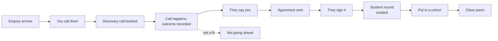
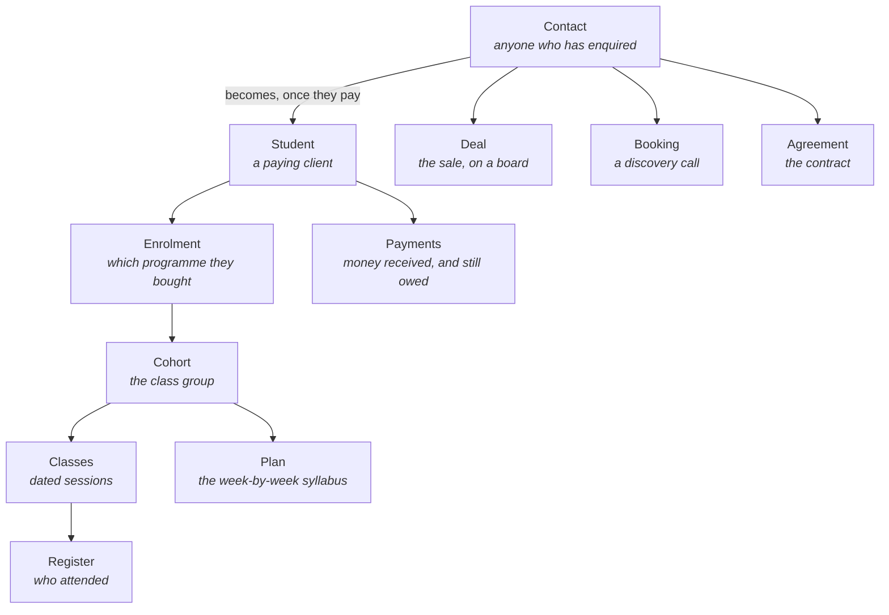
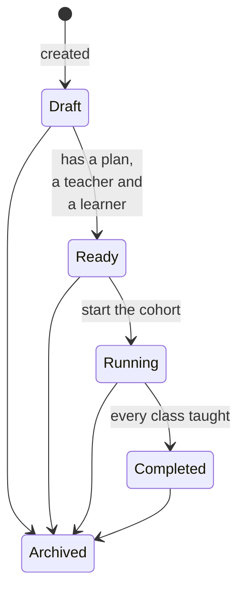

# The B2 Consultants app, explained

**Written for the founders and the team — no technical knowledge assumed.** If you have just been
given a login, read the first three sections and stop; the rest is reference for when you need it.

Last updated 23 October 2026.

---

## 1. What this app is for

It runs two businesses end to end:

- **B2 Consultants** — coaching programmes (Solo, Guided, Elite) for people moving to Germany.
- **German Note** — German language classes (A1 to B2), taught in cohorts.

Everything from a first enquiry to a student sitting in class happens here: capturing the enquiry,
calling them, booking the discovery call, agreeing the deal, signing the contract, taking the
money, putting them in a cohort, teaching the classes, taking the register, and reporting on all
of it.

**One idea explains most of the app.** Almost nothing is a status somebody has to remember to
update. Where a person has got to, whether a cohort is ready to teach, whether a contract is
signed — these are all **worked out from what is recorded**, every time you look at a screen. Log
the call and the person moves on by themselves. There is no second place to tick.

---

## 2. The journey everything is built around

This is the sequence the business actually runs, and the app is now shaped to match it:

**Payment is deliberately not one of the steps.** It happens at different points for different
people — a deposit before the contract, the balance after, sometimes instalments across the whole
thing. So the app treats it as *something outstanding* rather than a position in the queue, and it
shows up as a reminder wherever that person is.

### The one screen that runs it: Onboarding

**Where:** sidebar → Students → Onboarding.

It has four lists, and each answers a different question:

| List | The question it answers |
|---|---|
| **In flight** | Where is everybody? Grouped by the step they have reached. |
| **Needs completing** | Who is half-built? **The most useful list in the app** — see below. |
| **Stuck** | Who has had nothing recorded against them for ten days or more? |
| **Reached class** | Who got all the way through this month? |

Every row shows **the one thing to do next** and a **Go there** button that opens the right
screen. You never need to know which section that is.

**Why "Needs completing" matters.** A student record can come into existence six different ways —
including automatically, when somebody records a bank transfer in Finance. Three of those ways
leave a person with a name and a number and *nothing else*: no programme, no cohort, no login.
Before this list existed, nothing in the app named those people and they sat unfinished for weeks.

### Adding somebody: the guided flow

**Where:** Onboarding → **Add someone**.

One door. You type a name and a phone number, and from then on the screen tells you the single
next thing to do and takes you to it. You can stop at any point and come back days later — nothing
is lost, because your place is read from the records rather than saved as a step.

---

## 3. Who can do what

Six kinds of login:

| Role | What they are | What they see |
|---|---|---|
| **Founder / Admin** | Ameen and anyone given full access | Everything, including the Console and the activity log |
| **Head coach** | Runs delivery | Students, cohorts, attendance, pipeline visibility, their own daily log. **Not** finance |
| **Telecaller** | Sales | Their own desk, contacts, pipeline, bookings, the outreach queue |
| **Coach** | Teaches coaching cohorts | Their cohorts, the register, their students' progress |
| **Tutor** | Teaches German Note | Their batches, recordings, the community |
| **Student** | A paying client | Their own journey, timetable, recordings, the leaderboard |

Two things worth knowing:

- **The founder can change all of this.** Console → Access → Sections lets you rename, reorder,
  regroup, switch off any section, and set which roles see it. Individual people can be given or
  denied a section on top of that.
- **A screen you cannot open is also a screen you cannot reach by typing its address.** Access is
  enforced on the page itself, not just hidden from the menu.

---

## 4. The things the app keeps track of

In plain terms, and how they relate:

- A **contact** is anyone who has ever enquired. Everybody starts here.
- A **student** is a contact who has bought something. The two records stay joined, so you can
  always see somebody's whole history from first enquiry onward.
- An **enrolment** records *which programme* they bought. A student without one has bought nothing
  yet, which is why that counts as unfinished.
- A **cohort** (also called a batch) is a group of learners taught together.
- A **plan** is the week-by-week syllabus — written once, reused by every cohort that teaches it.

---

## 5. How a cohort works

A cohort has a life, and the app shows where in it each one is:

**Draft** means something it needs is missing. Open the cohort and a checklist names exactly what,
with a link to each fix:

1. A plan to teach from
2. Someone to teach it
3. A start date
4. Classes on the calendar
5. At least one learner

German Note cohorts are not asked for a plan or a built timetable — their classes are scheduled
one at a time, so those two do not apply.

**Start cohort** is disabled until a plan, a teacher and at least one learner exist, and the button
says which of the three is missing. Dates and a full timetable are on the checklist but do not
block starting — a cohort can legitimately begin before its later weeks are timed.

Nothing here is a status you set. Fill in the missing thing and the cohort changes by itself.

### Adding learners to a cohort

**Where:** Batches & Plans → the cohort → **Roster** → Add learners.

Pick as many people as you like at once. This used to be possible only from each student's own
record, one at a time — filling a twelve-seat cohort meant twelve separate trips.

---

## 6. Where to find things

| Group | What lives there |
|---|---|
| **My Work** | Your own desk, your daily log, the Arena, this guide |
| **Sales** | Pipeline, Contacts, Deals, Bookings (and the Outreach queue, reached from Pipeline) |
| **Students** | Onboarding, Students, Agreements, German Note |
| **Classroom** | My Teaching, Attendance, Batches & Plans, Leaderboard (students see My Classroom) |
| **Finance** | Finance, Cash Health, Payments, Bonus & Commission |
| **Marketing** | Website, Funnels, Forms, WhatsApp, Conversations |
| **Insights** | Reports, Funnel Report |
| **Admin** | Founder Console, Users, Programs, Activity Log |

**If you cannot find a screen:** open **App Guide** (sidebar → My Work). Every screen you can open
has a short how-to there with the click path written out, plus six full walkthroughs of the jobs
that cross several screens.

---

## 7. The thing that confuses people most

**Almost every automatic feature ships switched OFF.**

That is deliberate — nothing should start messaging clients or writing to the books because it was
installed. But the cost is that a feature which is built, switched off and unmentioned looks
exactly like a feature that is broken. The booking screen showed four zeroes for months because
nobody had saved the working hours, and everybody who looked at it concluded bookings were broken.

Two things now make this visible:

1. **Console → System → Not armed** lists all sixteen engines, what is *not* happening while each
   is off, and exactly where to switch it on.
2. **The screen itself says so.** Open Payments with chasing switched off and the screen tells you
   overdue balances are not being chased, and where to change that.

**Before reporting anything as broken, check that list.** Most reports have turned out to be an
engine nobody had armed.

The order to switch things on, if you are starting from scratch: the scheduler first (nothing
clock-driven works without it), then booking availability, then WhatsApp and email, then the
automatic messages one at a time, then last the ones that write to the books. There is a full
walkthrough of this in the App Guide — "Switch the app on".

---

## 8. Glossary

| Word | What it means here |
|---|---|
| **Agreement** | The coaching contract. Signed by the client on their phone. |
| **Batch / cohort** | A group of learners taught together. The two words mean the same thing. |
| **Capacity / target strength** | How many seats a cohort is meant to hold. Going over is allowed, with a warning. |
| **Contact / lead** | Anybody who has enquired. The same thing. |
| **Deal** | The sale, shown as a card on a board. Used to be called an Opportunity. |
| **Discovery call** | The first proper conversation, booked into a calendar slot. |
| **Enrolment** | The record of which programme a student bought. |
| **Engine** | Something the app does on its own — sending a reminder, chasing a payment. Usually off until switched on. |
| **Instalment plan** | An agreed total, paid in parts. "Paid so far" adds itself up. |
| **Journey** | Where somebody is between first enquiry and first class. Worked out, never typed in. |
| **Level** | A programme or language level — A1 to B2, or Solo / Guided / Elite. |
| **Plan / curriculum** | The week-by-week syllabus a cohort is taught from. |
| **Register** | Who attended a class. **Marking it is private; publishing it is what makes it count.** |
| **Roster** | The list of learners in a cohort. |
| **Seat** | One learner's place in a cohort. |
| **Section** | One item in the sidebar. The founder controls which exist and who sees them. |

---

## 9. If something looks wrong

In this order:

1. **Is the engine armed?** Console → System → Not armed. Most "broken" turns out to be here.
2. **Is it a waiting state?** "No cohorts yet" on a coach's screen means nobody has assigned them
   one — the screen is right, it is just waiting on somebody else.
3. **Does the screen name the fix?** Most empty screens now carry the button or the link that
   fills them.
4. **Is it in the App Guide?** If a screen has no entry there, that is a gap in the guide rather
   than something you are missing. Say so and it gets written.
