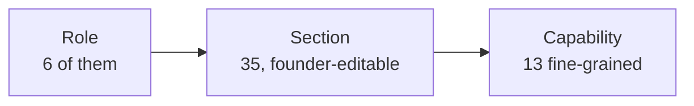

# Developer map

**Written for a developer joining this codebase.** Read sections 1–4 before touching anything;
the rest is reference. Companion to [APP_MAP.md](./APP_MAP.md), which explains the same app with
no code in it.

Last updated 23 October 2026, after the flow refactor (`docs/refactor/`).

---

## 1. The shape of it

Next.js 14.2 App Router, React 18, Prisma 6, PostgreSQL. Server components by default; client
components only where there is genuinely interaction.

```
src/
├── app/                      routes — Next.js App Router owns this convention
│   ├── (app)/<section>/
│   │   ├── page.tsx          thin: guard, server reads, layout
│   │   └── _components/      ← feature-local components, colocated
│   ├── api/                  webhooks, crons, file routes (37)
│   └── <public routes>        /book, /f/*, /s/*, /sign/*, /i/*
├── components/               cross-section UI (ui/, batches/, finance/, journey/, shell/…)
├── lib/                      PURE and isomorphic — no prisma, no server-only. The rules.
├── server/                   server-only. `*-actions.ts` write, `*-metrics.ts` read
├── documents/                PDF / DOCX renderers
└── middleware.ts
```

| | count |
|---|---|
| Pages | 74 |
| API routes | 37 |
| `server/` modules | 208 (188 carry `server-only`) |
| `lib/` modules | 158 |
| Shared components | 95 |
| Prisma models | 124 |
| `"use server"` files | 81 |
| Migrations applied | 111 |
| Test files / assertions | 108 / 1,915 |

### The one boundary that matters: `lib` vs `server`

**`lib` is pure.** No prisma import, no `server-only`, no I/O. It holds the *rules*: how a state
is derived, what a label reads, which prerequisites a thing needs. Because it is isomorphic, a
client component and a server component import the same truth and cannot disagree.

**`server` is `server-only`.** It holds the queries and the writes. `*-metrics.ts` reads,
`*-actions.ts` writes. A module that needs a rule imports it from `lib`.

Two rules the compiler will not always catch for you:

1. **Every export from a `"use server"` file must be `async`.** A type or a const export compiles
   under `tsc` and fails only in `next build`. Type-only exports have to move to a `lib` module —
   this has bitten twice (`SeatCandidate`, the agreement-enrol decision rule).
2. **A client component must never value-import a `server-only` module.** `import type` is erased
   so it appears to work, which is worse than a hard failure. Types shared with the client belong
   in `lib`.

### Folder structure: why there is no `/features` tree

It was considered and rejected — the reasoning is in
[`docs/refactor/04-refactor-plan.md` §1](./refactor/04-refactor-plan.md). In short: the app
already colocates per feature in the place the framework puts it (`app/(app)/<section>/_components/`),
the `lib`/`server` split is a real boundary a per-feature tree would either dissolve or recreate
38 times, and moving ~1,000 files would fix none of the 23 ranked problems.

---

## 2. Derived state: the pattern to copy

**Four lifecycles in this app are computed from the row on every render, not stored in a column.**
This is the codebase's most important convention, and new state should follow it.

| What | Rule lives in | States |
|---|---|---|
| Agreement lifecycle | `lib/agreement-state.ts` | 8 |
| Person's onboarding journey | `lib/journey-state.ts` | 10 steps + 7 gaps + `LOST` |
| Cohort readiness | `lib/batch.ts` | `DRAFT` / `READY` / `ACTIVE` / `COMPLETED` / `ARCHIVED` |
| Seat count | `lib/batch.ts` (`seatCount`) | — |

Why: a stored status column needs every writer to remember to update it, and one that forgets is
undetectable. A derived state is **always current because it is recomputed every render**. The
whole flow refactor added two new lifecycles and **zero migrations** because of this.

Two details worth copying:

- **`now` is passed in, never read from the clock inside the rule.** That is what makes these
  testable without freezing time.
- **In `journey-state.ts`, steps are reached independently by evidence, and gaps are separate from
  steps.** A German Note learner with no lead row has no `NEW` or `CONTACTED` and is still
  legitimately `SEATED`; a student who paid before signing has `WON` and `SIGNED` out of order.
  A strictly sequential reading would have to call both of those corrupt. Gaps **outrank**
  progress when deciding the next action, which is what makes "signed but never enrolled"
  expressible at all.

---

## 3. Access control: three layers, one rule function



| Layer | Where | What it gates |
|---|---|---|
| **Role** | `User.role` | The six kinds of login |
| **Section** | `lib/sections.ts` + `SectionsConfig` JSON in `AppSetting` | A whole screen |
| **Capability** | `lib/capabilities.ts` | One action inside a screen |

**`sectionAllowed()` in `lib/sections.ts` is the single rule.** The server guard
(`requireSection`) and the Console's own admin UI both call it, so what the nav shows and what a
route permits cannot drift apart.

Four flags on a catalogue entry, which are often confused:

| Flag | Meaning |
|---|---|
| `hidden: true` | Off the nav **and the route refuses**. Nothing carries it today. |
| `offRail: true` | Off the nav, route still open. Reached from a sibling screen (`outreach`). |
| `locked: true` | Always on, ADMIN-only, cannot be switched off (`console`, `activity`). |
| `personal: true` | STUDENT-only self-scoped page. Not founder-overridable — it is a fact about the code. |

`resolveSections(config)` layers the saved founder config over the catalogue: unknown saved keys
are ignored, missing keys fall back. **`href` is never overridable** — only `label`, `icon`,
`group`, `order`, `enabled` and `roles` are. That is why re-pointing a section needs no migration.

The 13 capabilities: `finance.write`, `pipeline.configure`, `users.manage`, `rewards.approve`,
`agreements.issue`, `outreach.qualify`, `germanNote.finance`, `sites.manage`, `batches.manage`,
`qualification.manage`, and three commission earners (`commission.firstCall`,
`commission.discovery`, `commission.closer`).

**`lib/permission-matrix.ts` is a drift reporter, not an enforcer.** It encodes the spec's own
role × module table and reports where the app is wider, narrower, or cannot express the rule at
all. Rows with `sections: []` report `NOT_GATEABLE` — including `ledger`, kept deliberately after
that screen was removed so the spec's unmet ask stays visible instead of disappearing with it.

---

## 4. Route → page → server → table, per flow

### Onboarding (the journey)

| Route | Page | Server | Tables |
|---|---|---|---|
| `/onboarding` | `app/(app)/onboarding/page.tsx` | `server/onboarding-metrics.ts` → `getOnboardingBoard()` (**fixed 5 queries**) | `Lead`, `Student`, `Enrollment`, `Agreement`, `BatchMember`, `Batch`, `ClassSession` |
| `/onboarding/new` | `.../new/page.tsx` + `_components/` | `getPersonJourney()` (4 queries); writes delegate to `contacts-actions`, `students-actions` | as above |

Rules: `lib/journey-state.ts` (pure), `lib/journey-links.ts` (the **only** place journey route
strings live). The rail component is `components/journey/JourneyRail.tsx`, mounted on
`/contacts/[id]`, `/students/[id]` and the wizard — one component, one derived state.

### Cohorts

| Route | Page | Server | Tables |
|---|---|---|---|
| `/batches` | `app/(app)/batches/page.tsx` | `server/batches.ts` → `getBatchBoard(line)` | `Batch`, `Enrollment`, `BatchMember`, `ClassSession`, `CurriculumTemplate` |
| `/batches/[batchId]` | `.../[batchId]/page.tsx` | `server/batch-detail.ts` → `getBatchDetail`, `canSeatBatch`, `listSeatCandidates` | as above + `Attendance`, `Resource` |
| writes | — | `server/batch-actions.ts` (`upsertBatch`, `seatEnrollment`, `activateBatch`), `server/batch-seats.ts` (`addSeats` — a **dispatcher**, not a new writer) | `Batch`, `Enrollment`, `BatchMember` |

Rules: `lib/batch.ts` — `seatMechanism`, `seatCount`, `batchBlockers`, `activationBlockers`,
`batchReadiness`, `canActivateBatch`, `describeBlockers`.

**⚠ `Batch` has two parallel membership mechanisms.** B2 seats through `Enrollment.batchId`;
German Note through the `BatchMember` join table. Nothing in the schema marks which applies —
`Batch.line` decides it by convention, and `seatMechanism(line)` is the one place that convention
is written down. This is the deepest structural issue in the codebase; `seatCount()` exists
because two capacity checks disagreed about it and let a ninth person into an eight-seat cohort.

### Sales

| Route | Page | Server | Tables |
|---|---|---|---|
| `/pipeline` | `app/(app)/pipeline/page.tsx` | `server/pipeline-metrics.ts` | `Lead`, `CallLog`, `DiscoveryOutcome`, `LeadStageHistory` |
| `/opportunities` ("Deals") | `app/(app)/opportunities/page.tsx` | `server/opportunities-metrics.ts` | `Opportunity`, `Lead`, `PipelineStage` |
| `/contacts` | `app/(app)/contacts/page.tsx` | `server/contacts-metrics.ts` | `Lead`, `Company`, `CustomField` |
| `/bookings` | `app/(app)/bookings/page.tsx` | `server/bookings-metrics.ts` | `BookingRequest`, `Slot`, `SlotRelease` |

**⚠ One deal has two status fields** — `Lead.stage` and `Opportunity.stageId` — kept in step by
`server/opportunity-sync.ts`. Surfaced as two boards on purpose (funnel vs. drag-and-drop), but
they are one deal.

### Money

| Route | Page | Server | Tables |
|---|---|---|---|
| `/finance` | `app/(app)/finance/page.tsx` | `server/finance-metrics.ts`, writes in `finance-actions.ts` | `Income`, `Expense`, `PendingPayment`, `Instalment` |
| `/payments` | `app/(app)/payments/page.tsx` | `server/invoices-*.ts`, `products-*.ts` | `Invoice`, `Product`, `Subscription`, `Receipt` |

Every posting goes through `server/ledger-core.ts` (double-entry). The ledger **screen** was
removed 23 Oct 2026; the engine is untouched and six modules still post through it. The three read
functions (`getTrialBalance`, `getJournal`, `verifyAuditChain`) still exist in `ledger-core.ts`
and take a `LedgerDb` — the door is closed, not bricked up.

### Engines

`server/not-armed.ts` reports all sixteen on the Console; `server/engine-status.ts` answers
"is *this screen's* engine on?" per screen; copy for both lives once in `lib/engines.ts`. Eight
screens render `EngineOffNotice`. `cron` and `intake` are deliberately Console-only — both need
uncached queries and belong to no single screen.

---

## 5. Where each lifecycle rule is enforced

| Rule | Enforced in | Notes |
|---|---|---|
| Who may open a screen | `lib/sections.ts` `sectionAllowed()` via `requireSection()` | One function, two callers |
| Who may do an action | `lib/capabilities.ts` via `requireCapability()` | |
| Agreement state | `lib/agreement-state.ts` | Derived, 8 states |
| Journey state | `lib/journey-state.ts` | Derived; gaps outrank progress |
| Cohort readiness | `lib/batch.ts` | Derived; GN exempt from plan + timetable |
| Seat capacity | `lib/batch.ts` `seatCount()` | Over-capacity **warns**, never blocks |
| Level fits the line | `lib/batch.ts` `levelFitsBatchLine()` | Guards the one-table `Batch` |
| Which seat mechanism | `lib/batch.ts` `seatMechanism()` | The only written record of the convention |
| Enrolment occupies a seat | `lib/enrollment-lifecycle.ts` `SEATED_STATUSES` | 21 call sites read this one constant |
| Delivery fence (whose cohort) | `server/batch-access.ts` | **One rule.** Three read-side copies once omitted HEAD — never re-derive it |
| Instalment maths | `lib/instalment-plan.ts` | Pure |
| Payment allocation | `lib/payment-allocation.ts` | Fixed "paid so far summed per student" |

---

## 6. Checklist: adding a feature that fits the flow

1. **Is it a rule or a query?** Rules go in `lib` (pure, tested, isomorphic). Queries and writes
   go in `server`.
2. **Can the state be derived?** Prefer it. A stored status needs every writer to maintain it.
3. **Reuse the writer.** If an action already does this job, dispatch to it (see
   `server/batch-seats.ts`) rather than writing a second path. Two paths to one rule is how the
   capacity bug happened.
4. **Add the section** to `SECTION_CATALOGUE` with `key`, `label`, `href`, `group`, `roles`, and
   an `icon` registered in `components/shell/section-icons.tsx`.
5. **Guard the route** with `requireSection("<key>")` — the same key the nav entry uses. A nav
   entry gated on one key opening a route gated on another is finding P7, and it was real.
6. **Write the guide entry** in `lib/guide-content.ts` with its `path` click-path.
   `sections-structure.test.ts` **fails** without it — that is deliberate, a section cannot ship
   undocumented.
7. **Give every empty state an `action`** unless it is genuinely waiting on somebody else.
   `empty-states.test.ts` holds the list of both kinds.
8. **If it has an engine**, add it to `lib/engines.ts`, a check in `server/engine-status.ts`, and
   render `EngineOffNotice` on its screen. `engines.test.ts` fails if either consumer is missed.
9. **Run all three checks**: `npm test`, `npm run lint`, `npx tsc -p tsconfig.json --noEmit`.
10. **Run a real `next build`** before deploying — it is the only thing that catches a non-async
    `"use server"` export.

---

## 7. Environment traps

These have each cost a day at least once.

**`npm run deploy:preflight` checks most of this table for you.** It asks the questions below that
have definite answers - is the Docker daemon actually answering (not just "is Docker Desktop
running"), are we on `master`, is the tree clean, is anything unpushed, does `tsconfig.json`
include a path that no longer exists, how many `b2-app` tags are piled up locally - and exits
non-zero if any of them is wrong. It starts Docker Desktop and waits up to three minutes if the
daemon is down, which is the fix for the three consecutive deploys that opened that way.

Docker Desktop's own "start when you sign in" is deliberately left OFF: nearly every startup item
on this machine is disabled, which is a considered choice, and a weekly deploy is a poor reason to
overturn it. The daemon is needed at deploy time, so that is where the preflight starts it.

| Trap | What to do |
|---|---|
| **`.env` points at LIVE Supabase** | Never `prisma migrate deploy` with a shell-set `DATABASE_URL` — `.env` wins. Local Postgres is on `:5435` via `.env.local`. |
| **WhatsApp reaches real numbers** | `testRecipient` is null and `WATI_ENABLED=true`. There is no test mode. |
| **A bare `next build` corrupts `.next`** | The dev server owns it. Always `NEXT_DIST_DIR=…` out of band, and launch long builds detached. |
| **`docker build` ships the working tree** | Build from `git archive HEAD`, not the dirty tree. |
| **`next lint` / `next build` edit `tsconfig.json`** | They re-append `include` paths. Keep it to the documented two entries; delete anything else. |
| **Migrations are not in the image** | Run `npm run db:deploy` *before* shipping the image. |
| **One shared Chrome profile** | Browser-driven scripts can fail on a profile lock while another session has one open. |
| **Host memory** | `next build` and `tsc` have both OOM'd on a machine with ~500 MB free. `npm test -- --test-concurrency=2` and `NODE_OPTIONS=--max-old-space-size=2048` for `tsc`. |

---

## 8. Reading order for the refactor

If you want the reasoning behind the current shape:

| Document | What it holds |
|---|---|
| `docs/refactor/01-inventory.md` | 149 features, every screen, entity, role, capability, and 9 permission gaps |
| `docs/refactor/02-current-state.md` | 25 diagrams, the dependency map, 23 ranked problems |
| `docs/refactor/03-target-design.md` | The decisions (D1–D6), target IA, lifecycle diagrams, full feature mapping |
| `docs/refactor/04-refactor-plan.md` | 30 steps in 8 waves, each with goal / files / data / risk / verification |
| `docs/refactor/05-progress.md` | What was actually done, the bugs found on the way, and what was deliberately not done |
| `docs/refactor/CHANGELOG.md` | Before / after per flow, with step counts |
