# 02 — Current state

**Phase 2 of the flow refactor. Read-only: no application code was changed to produce this.**

Follows [01-inventory.md](./01-inventory.md). Everything here is drawn from the schema and the code as
it stands at `141cbfe`.

---

## 1. Entity relationship diagram

124 models is too many to read on one page, and most of the tail (ledger lines, FX rates, media assets,
webhooks, snippets) carries no *flow*. What follows is the **real data model of the journeys** — the
four clusters a user actually moves through — with every relation taken from the schema, not inferred.

### 1.1 Sales: stranger → deal

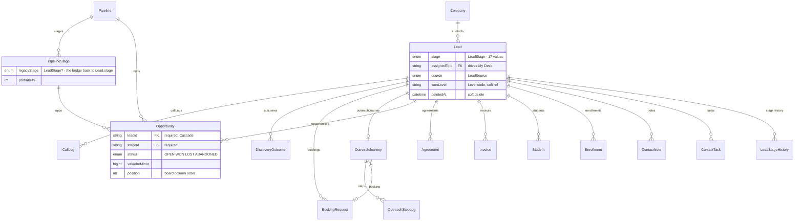

> **The duplication, in one line.** `Lead.stage` and `Opportunity.stageId` are two status fields for
> one deal. `PipelineStage.legacyStage` is the bridge, and `src/server/opportunity-sync.ts` keeps them
> in step in application code. Nothing in the database enforces it.

### 1.2 Contract and money: deal → paid

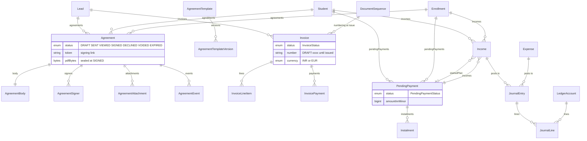

> **Two gaps visible here.** `Invoice` links to `Lead` only — **not** to `Student` or `Enrollment`. And
> `Agreement` can point at a Lead, a Student *and* an Enrollment, all optional, so "whose contract is
> this" has three possible answers and no required one.

### 1.3 Delivery: student → taught

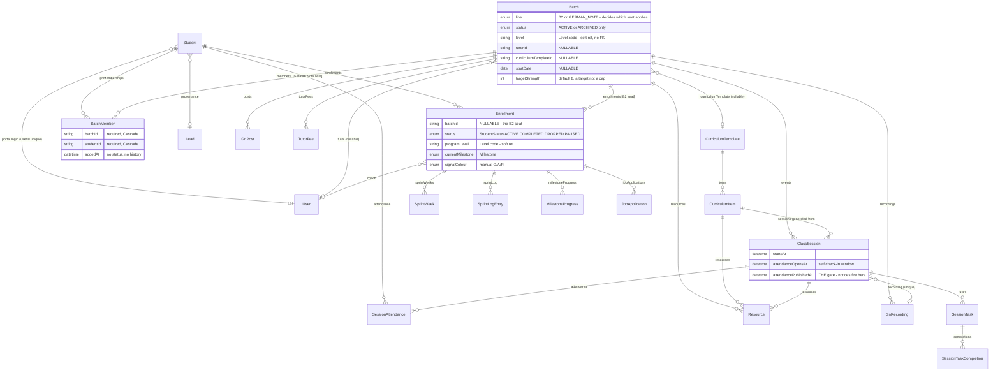

> **The two-seats problem, drawn.** `Batch` has two membership edges — `Enrollment` and `BatchMember` —
> and the schema gives no hint which applies. `Batch.line` decides, by convention enforced only in
> application code.

### 1.4 People and access

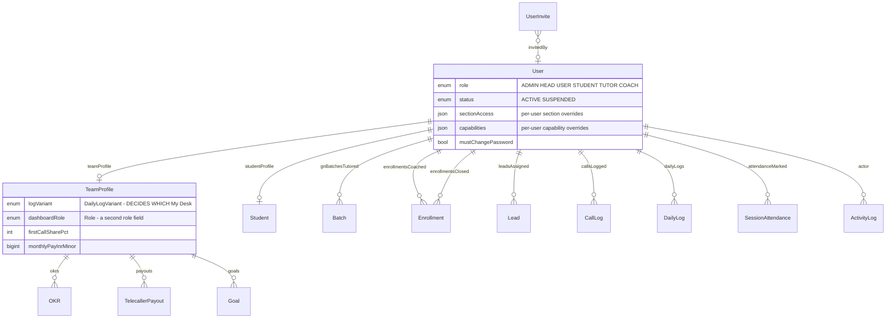

> **Two role fields.** `User.role` gates everything. `TeamProfile.dashboardRole` is a second, unenforced
> copy, and `TeamProfile.logVariant` decides which My Desk variant renders — a behaviour the access UI
> can neither show nor set.

### 1.5 The `Level` anomaly

`Level` has **zero relations in the schema**. It is referenced as a bare `String` by code in ten places
(`Batch.level`, `Enrollment.programLevel`, `Lead.wonLevel`, `Product.levelCode`, `CurriculumTemplate.levelCode`,
`InvoiceLineItem`, `TutorFee.level`, and others — see `grep "Level.code" prisma/schema.prisma`).

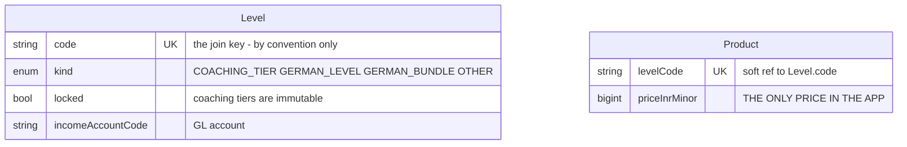

Nothing in the database prevents a `Batch` pointing at a level code that does not exist. Validation is
in `upsertBatch` and friends. This is deliberate (the enum→table migration is documented at
`schema.prisma:271`), but it is the reason "which programmes can I run a batch for?" is a code question,
not a query.

### 1.6 Clusters not drawn

Intentionally omitted as flow-irrelevant, but present and accounted for in the inventory:
marketing (Site/SitePage/Funnel/FunnelStep/Form/FormSubmission/SectionSnippet/MediaAsset),
messaging (Message/MessageTemplate/WhatsAppMessage/WhatsAppOptOut/ConsentRecord),
German Note community (GnPost/GnComment/GnLike/GnModule/GnRecording/GnPendingJoiner),
workshops (Workshop/WorkshopRegistration/GnWorkshopConversion),
gamification (RewardRule/RewardGrant/MilestoneLog), automation (Workflow/WorkflowEnrollment/WorkflowFolder),
and operations (AppSetting/ActivityLog/AuditEntry/PeriodLock/DocumentSequence/FxRate/AdSpend).

---

## 2. Dependency map — what must exist first

### 2.1 Prerequisites, as the code actually enforces them

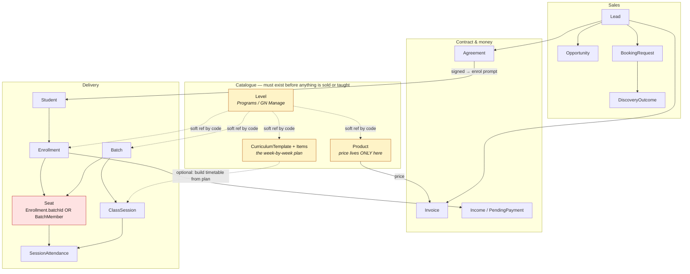

Solid arrow = enforced by a foreign key. Dotted arrow = a string match validated in application code.

### 2.2 What is *not* required, and should be

| You can create… | …without | Consequence |
|---|---|---|
| A `Batch` | a tutor (`tutorId` nullable) | Nobody is scoped to teach it; it appears on no coach's desk |
| A `Batch` | a curriculum (`curriculumTemplateId` nullable) | No timetable can be generated; students see an empty Classroom |
| A `Batch` | dates (`startDate`/`endDate` nullable) | It cannot be sequenced or reported on |
| A `Batch` | any members | `ACTIVE` and empty is indistinguishable from `ACTIVE` and running |
| A `Batch` | a valid `level` | No FK — only `upsertBatch` checks |
| An `Enrollment` | a batch (`batchId` nullable) | The student has bought but is in no class |
| An `Enrollment` | a coach (`coachId` nullable) | Nobody owns their progress |
| A `ClassSession` | a `curriculumItemId` | It exists outside the plan; week numbering is manual |
| A `Student` | a `User` (portal login) | They cannot sign in to see any of it |
| A `Product` | existing (0 products on live until recently) | The invoice programme picker is empty |

### 2.3 The chain stated plainly

> A **Batch** can be created without a syllabus, without a teacher, without dates and without students,
> and it is `ACTIVE` from the moment it is saved. Learners can see no content until a
> **CurriculumTemplate** is attached *and* a timetable is generated from it. A **Student** can be
> enrolled without a seat, and a seated student still sees nothing until a **ClassSession** exists.
> Attendance cannot be taken until a session exists, and no absence notice fires until the register is
> **published**. None of these six prerequisites is visible on any one screen.

---

## 3. Current user journeys

Measured against the code. Friction points are marked ⚠ in the diagrams and listed after each.

---

### 3.0 THE MASTER JOURNEY — lead → discovery → payment → agreement → batch → class

> *"A student comes in as a lead, then goes through a discovery call, then accepts, pays and signs
> the agreement, then is put into a batch, then class starts. This must be done accordingly. There
> are too many sections to add a student and I myself can't understand."* — founder, 23 Oct 2026

This is the journey the business runs on, and it is the one the app does not have. Below is what it
actually takes today, traced through the code. **It crosses 6 nav groups, 9 screens and 5 sections,
and no single screen shows where a person has got to.**

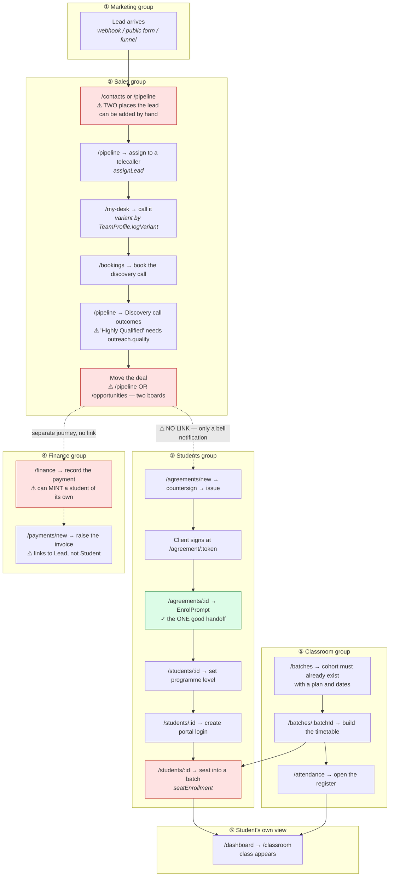

#### 3.0.1 Six doors create a student

There is no single "add a student" action. **Six separate UI paths end with a `Student` row
existing**, five of them writing `prisma.student.create` directly:

| # | Door | Screen | Action | Creates an enrolment? | Creates a login? |
|---|---|---|---|:-:|:-:|
| 1 | Manual form | `/students?tab=all` | `students-actions.ts:148` `createStudent` | optional | no |
| 2 | CSV import | `/students?tab=import` | `student-import-actions.ts:70` | yes | no |
| 3 | Convert a lead | `/contacts/[id]` | `students-actions.ts:225` `convertLeadToStudent` | **no** | no |
| 4 | After signing | `/agreements/[id]` EnrolPrompt | `agreement-enrol.ts:93` → door 3 | **no** | no |
| 5 | **Recording a payment** | `/finance` income form | `finance-actions.ts:516` (`mintStudent`) | **no** | no |
| 6 | Approve a GN joiner | `/german-note/manage` | `german-note-actions.ts:313` | n/a — writes `BatchMember` | no |

Door 5 is the one that makes the app un-followable: **typing an income entry can bring a student
into existence.** It is well-written — it name-matches against the roster before minting, and
allocates a code in the right series — but it means the Students board can grow a row because
somebody recorded a bank transfer.

Doors 3, 4 and 5 all create a `Student` with **no `Enrollment`**, so the person exists but has
bought nothing, is in no batch, has no programme level, and no portal login. There is no screen
that lists people in that state.

> To be fair to the code: doors 3 and 4 are deliberately the *same* function —
> `agreement-enrol.ts:30` says it "reuses `convertLeadToStudent` rather than creating a second
> Student-creation path". The awareness is there. The problem is the number of *doors*, not the
> number of implementations.

#### 3.0.2 Step count, today

| Stage | Screens | Nav groups | Who can do it |
|---|:-:|:-:|---|
| Lead in → assigned | 2 | Sales | ADMIN, USER |
| Called → booked → qualified | 3 | Sales (+ `outreach.qualify`) | USER, ADMIN |
| Deal moved to won | 1 of 2 boards | Sales | ADMIN, HEAD, USER |
| Agreement issued → signed | 2 | Students | ADMIN (`agreements.issue`) |
| Student created | 1 of **6** doors | Students / Finance / Sales / Classroom | varies |
| Programme level + login + seat | 1 screen, 3 separate controls | Students | ADMIN |
| Payment + invoice | 2 | Finance | ADMIN (`finance.write`) |
| Cohort + plan + timetable | 2–3 | Classroom | ADMIN only |
| Register opened | 1 | Classroom | ADMIN, HEAD, COACH, TUTOR |
| **Total** | **~15 screens across 6 nav groups** | | **no screen shows overall progress** |

#### 3.0.3 What is missing, precisely

1. **No journey object.** Nothing in the schema represents "this person's progress from stranger to
   student". `Lead.stage` covers the sales half (17 flat values ending at `WON`) and `Enrollment`
   covers the delivery half. Nothing joins them, so nothing can render a progress bar.
2. **No handoff at the seam.** `Lead.stage = WON` is where the sales half ends and nothing on either
   board mentions an agreement (P5). The only prompt is a notification.
3. **No single "add a student" door**, and the six that exist disagree about what else to create.
4. **No readiness view.** No screen answers "who has signed but is not seated", "who is seated but
   has no login", "who has paid but has no enrolment" — all three states are reachable and none is
   listed anywhere.
5. **No ordering guidance.** Nothing tells you the cohort must exist *before* you can seat anyone, or
   that the plan must exist before the timetable, or that the register must be *published*.

---

### 3.1 ADMIN — the founder

#### Job A1: Start a new coaching cohort with learners and a syllabus

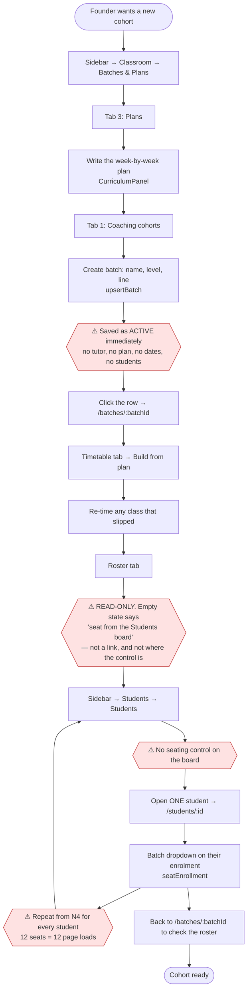

**Steps: 13 screens for a 12-seat cohort, ~26 page loads.**

Friction:
- **F1.** `upsertBatch` ([`batch-actions.ts:62`](../../src/server/batch-actions.ts)) requires only name, level and line. The cohort is `ACTIVE` with nothing attached and nothing says so.
- **F2.** The Roster tab is read-only ([`batches/[batchId]/page.tsx:144-192`](<../../src/app/(app)/batches/[batchId]/page.tsx>)); its empty state has no `action`.
- **F3.** The pointer is wrong: the control is on `/students/[id]`, not `/students`.
- **F4.** Seating is one enrolment at a time ([`StudentDetailClient.tsx:50-100`](<../../src/app/(app)/students/[id]/_components/StudentDetailClient.tsx>)). No bulk, no CSV, no multi-select.
- **F5.** Three doors to create the same cohort (`/batches`, `/students?tab=batches`, `/german-note/manage`) and two to write the plan (`/batches?tab=2`, `/programs?tab=curriculum`).
- **F6.** No notification covers this journey — nothing in the 45-item feed points at `/batches`.

#### Job A2: Turn a won deal into a paying, taught student

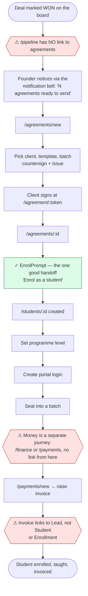

Friction:
- **F7.** The sales→contract handoff exists only as a **notification**. `/pipeline` and `/opportunities` contain no reference to agreements at all (`grep "agreements" pipeline/page.tsx` → nothing). Only `/contacts/[id]` carries an `AgreementTaskCard`.
- **F8.** `EnrolPrompt` ([`agreements/[id]/_components/EnrolPrompt.tsx`](<../../src/app/(app)/agreements/[id]/_components/EnrolPrompt.tsx>)) is the model the rest of the app should copy — it names the next two steps in prose and links to them. It is one of only 11 empty/next-step surfaces with an action.
- **F9.** `EnrolPrompt` names "programme level" and "portal login" but **not** seating — the step after.
- **F10.** Invoicing is disconnected from the student record (`Invoice.leadId` only).

#### Job A3: Record money in / money out

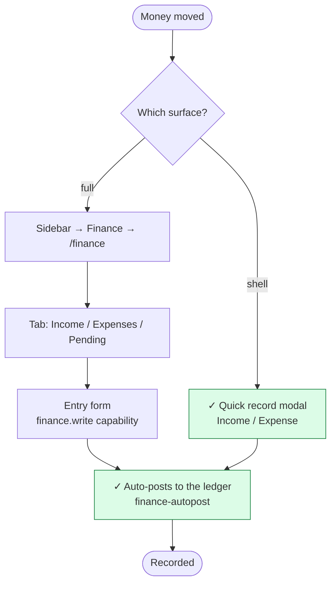

**Clean.** Two doors, both correct: a shell-level quick action for speed and the full screen for
context. This is the pattern Job A1 lacks.

#### Job A4: Set up a new programme and its price

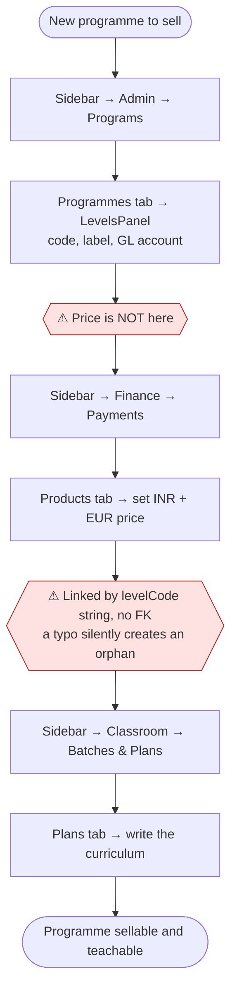

Friction:
- **F11.** One concept — "a programme we sell" — is spread across three sections in three nav groups (Admin → Programs, Finance → Payments, Classroom → Batches & Plans), joined by an unenforced string.
- **F12.** `LevelsPanel` is also mounted at `/german-note/manage?tab=levels`, so the same editor appears under two headings for two disjoint slices of one table.

#### Job A5: Grant someone access

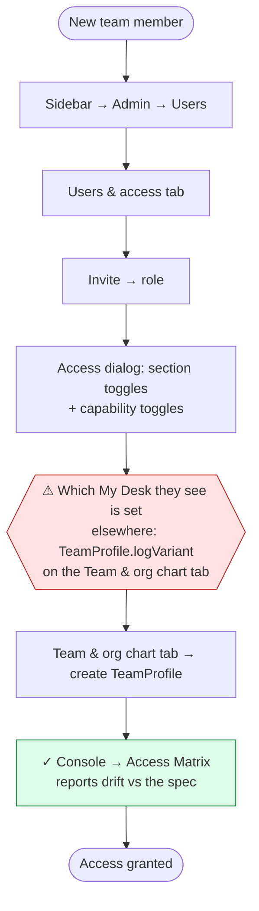

Friction:
- **F13.** A person is two records (`User` + `TeamProfile`) created on two tabs, and the second decides a visible behaviour the first's access UI never mentions. A USER invited without a `TeamProfile` lands on My Desk and reads *"No team profile linked to your login"*.

#### Job A6: Check how the business is doing

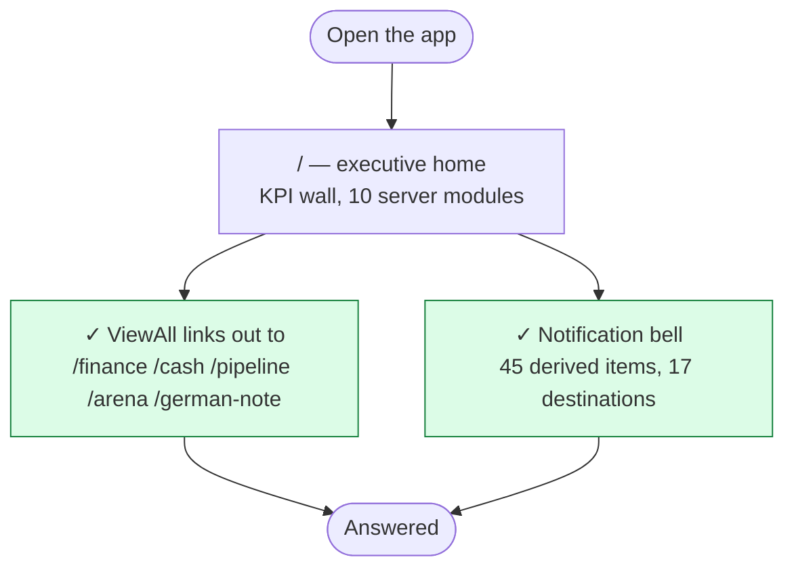

**Clean.** The home page and the bell are the app's strongest flow surfaces.

#### Job A7: Arm a background engine

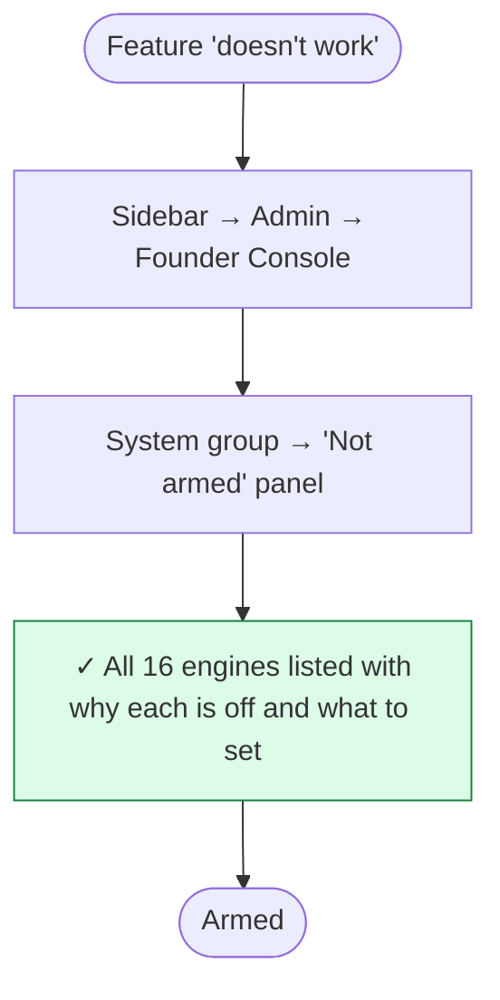

**Clean**, and the answer to most "this is broken" reports. The only friction is that nothing on the
*feature's own screen* says it is disarmed — you have to know the Console panel exists.

#### Job A8: Run a report

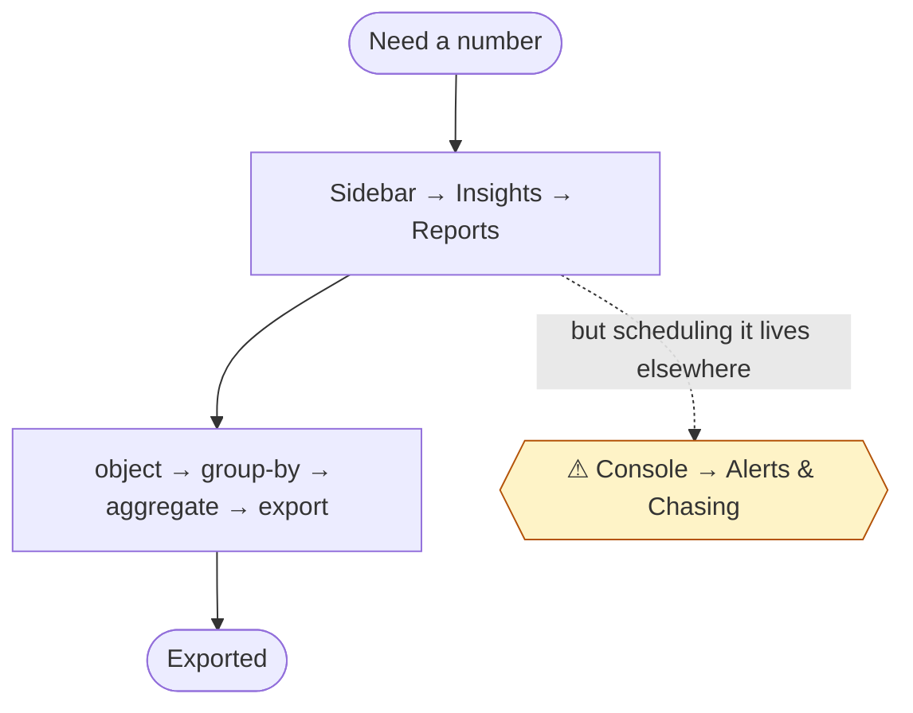

---

### 3.2 HEAD — the head coach

#### Job H1: See which students are at risk

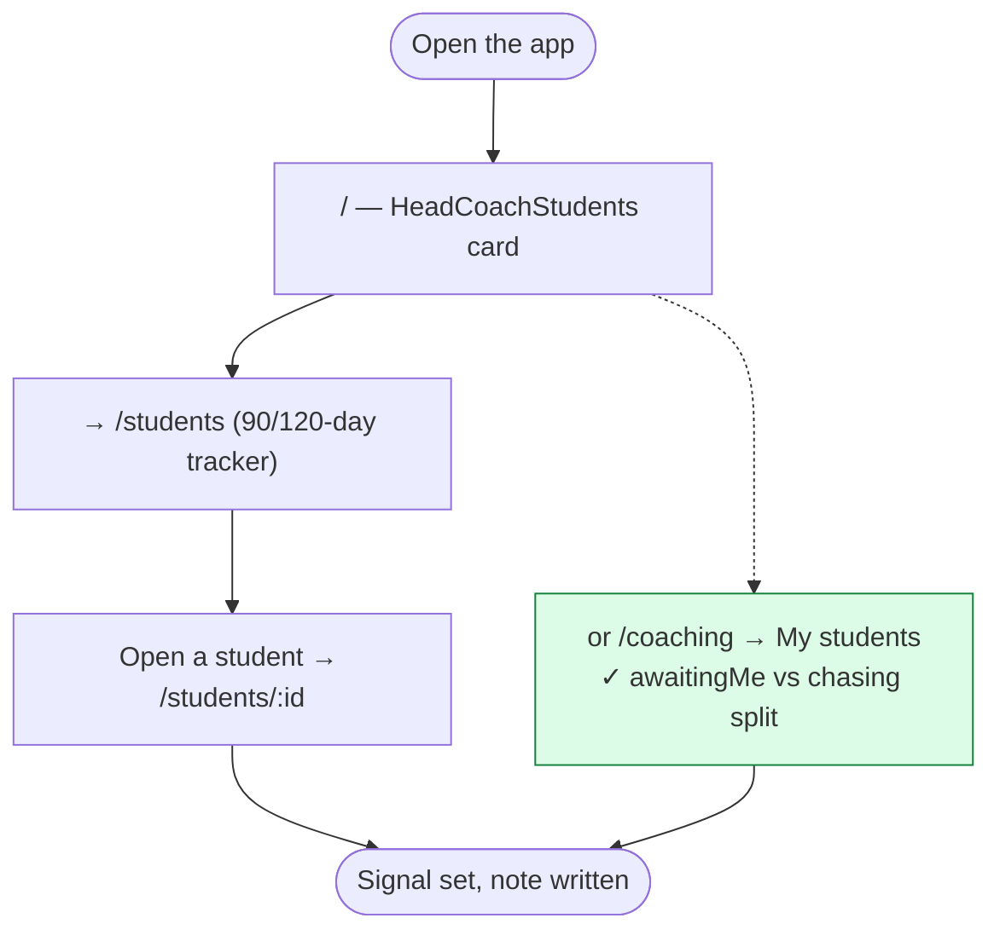

**Mostly clean.** `/coaching` deliberately splits "waiting on you" from "chasing them"
([`coaching/page.tsx:44-49`](<../../src/app/(app)/coaching/page.tsx>)) — a good distinction. Friction:
two boards answer the same question (`/students` tracker and `/coaching` My students).

#### Job H2: Mark a register

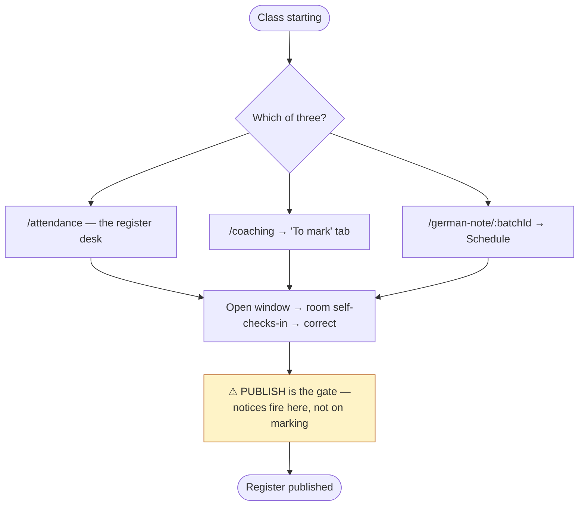

Friction:
- **F14.** Three surfaces for one job. Defensible (the desk is for the first two minutes of class; the tabs are for corrections a week later) but undocumented in the UI — nothing on any of the three says which is which.
- **F15.** The mark/publish distinction is load-bearing and invisible: marking does nothing until publish.

#### Job H3: Write the daily log · H4: Oversee cohorts · H5: Discontinue a student

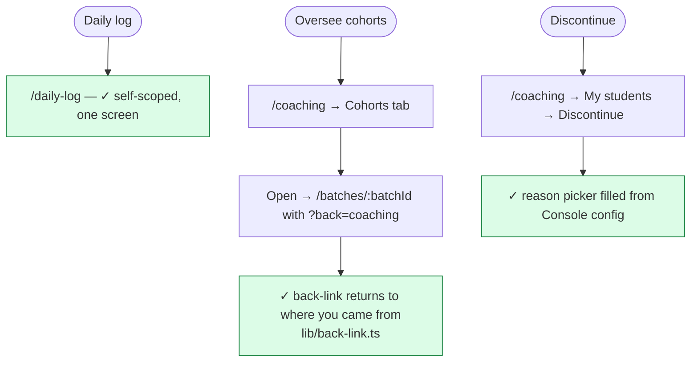

**Clean.** `resolveBackLink` is the right answer to "four screens link here" and should be the model for
the rest of the app.

---

### 3.3 USER — the telecaller

#### Job U1: Work today's call list

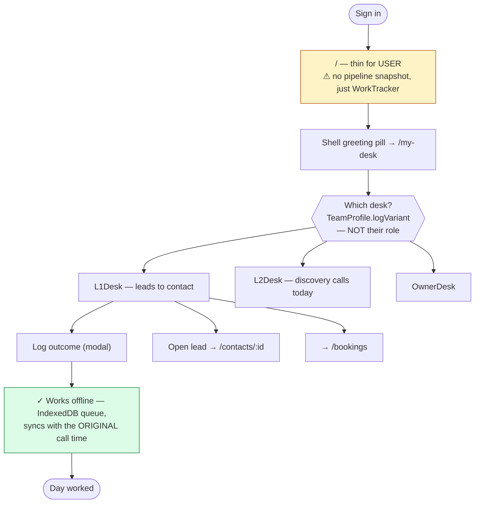

Friction:
- **F16.** A telecaller's home is `/` — a founder KPI page with most tiles withheld. Their real home is `/my-desk`, reached via a shell pill rather than a redirect. The three other non-admin roles *do* get a redirect ([`page.tsx:71-75`](<../../src/app/(app)/page.tsx>)).
- **F17.** `/my-desk` shows "No team profile linked to your login" (twice) for a USER whose `TeamProfile` was never created — a setup dead end with no action and no explanation of who can fix it.

#### Job U2: Book a discovery call · U3: Record the outcome and qualify

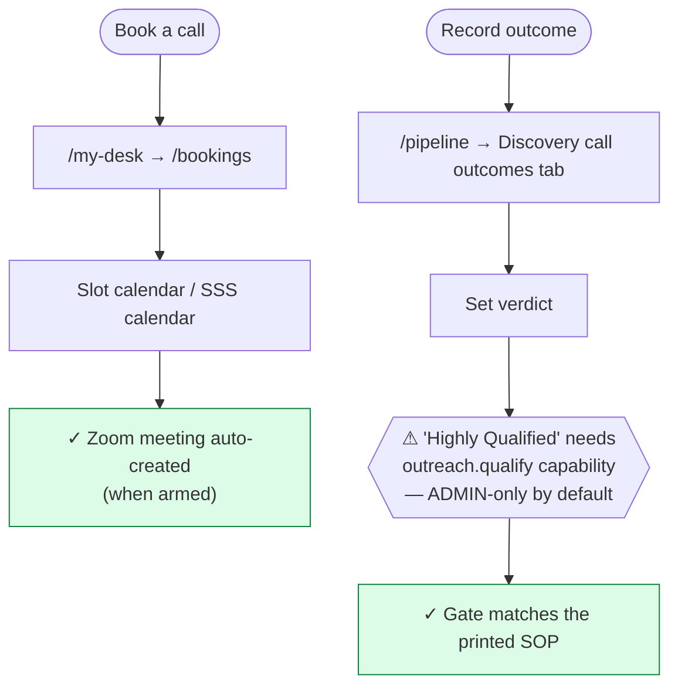

#### Job U4: Move a deal on the board

```mermaid
flowchart TD
    START([Deal progressed]) --> Q{{"⚠ TWO boards"}}
    Q --> A["Sidebar 'Pipeline' → /opportunities<br/>kanban of Opportunity.stageId"]
    Q --> B["/pipeline — kanban of Lead.stage<br/>⚠ NOT on the sidebar at all<br/>566 lines, 24 inbound links"]
    A --> SYNC["opportunity-sync.ts mirrors<br/>the move back onto Lead.stage"]
    B --> SYNC
    SYNC --> W{{"⚠ Deal marked WON — and nothing<br/>on either board mentions an agreement"}}
    W --> DONE([Deal moved, handoff missed])
    style Q fill:#fee2e2,stroke:#b91c1c
    style B fill:#fee2e2,stroke:#b91c1c
    style W fill:#fee2e2,stroke:#b91c1c
```

Friction:
- **F18.** Two boards over one deal. Documented as deliberate-for-now in `sections.ts`, with merging called out as "a separate, larger piece of work".
- **F19.** The nav item labelled "Pipeline" has `key: "pipeline"` but `href: "/opportunities"`, and the destination runs `requireSection("opportunities")`. Split those two sections in the Console and the user's own nav item bounces them.
- **F20.** `/pipeline` has no section of its own — the busiest sales screen in the app has no door.

#### Job U5: Run the outreach SOP · U6: Check own commission

```mermaid
flowchart TD
    U5([Run the SOP]) --> S1["/outreach — 23-step queue<br/>⚠ offRail: not on the sidebar"]
    S1 --> S2["Reached as a Pipeline tab, or from<br/>/opportunities, or the owner desk"]
    S2 --> S3["⚠ Engine needs a 1-minute cron;<br/>ships disarmed"]
    U6([Own commission]) --> C1["/my-desk → OwnCommission tile ✓"]
    C1 --> C2["Team board is /telecaller<br/>— ADMIN/HEAD only, correctly"]
    style S1 fill:#fef3c7,stroke:#b45309
    style S3 fill:#fef3c7,stroke:#b45309
    style C1 fill:#dcfce7,stroke:#15803d
```

---

### 3.4 COACH

```mermaid
flowchart TD
    START([Sign in]) --> R["✓ / redirects to /coaching"]
    R --> T1["This week — upcoming classes"]
    R --> T2["To mark — registers due"]
    R --> T3["Cohorts — what I lead"]
    R --> T4["My students — sprint check-ins"]
    T1 --> S1["Open class → /batches/:batchId?back=coaching"]
    S1 --> S2["Timetable · Resources · Roster"]
    S2 --> W1{{"⚠ Roster read-only;<br/>coach cannot seat even with batches.manage,<br/>because /batches is requireAdmin"}}
    T2 --> M["Open register → mark → publish"]
    T4 --> C["Sprint week verdict · discontinue"]
    style R fill:#dcfce7,stroke:#15803d
    style W1 fill:#fef3c7,stroke:#b45309
```

**The best-connected role in the app.** One self-scoping desk, four tabs that are four real jobs, and
origin-aware back-links. Friction: **F21** — the `batches.manage` capability exists and is grantable,
but the only screen that creates cohorts is `requireAdmin()`, so a COACH granted it can seat students
only by opening each student's record, a screen they often cannot see (`students` is not in COACH's
section list).

### 3.5 TUTOR — German Note

```mermaid
flowchart TD
    START([Sign in]) --> R["✓ / redirects to /german-note"]
    R --> T1["Financials tab — gated on germanNote.finance"]
    R --> T2["Community tab"]
    R --> N1["Cohort → /german-note/:batchId"]
    N1 --> T3["Classroom · Schedule · Discussion"]
    T3 --> M["Mark register from Schedule"]
    R --> ALT["Also has /coaching — the same desk<br/>⚠ two homes for one teaching job"]
    ALT --> W1{{"⚠ GN membership is BatchMember,<br/>managed from /german-note/manage or<br/>/german-note/members — two screens"}}
    style R fill:#dcfce7,stroke:#15803d
    style ALT fill:#fef3c7,stroke:#b45309
    style W1 fill:#fee2e2,stroke:#b91c1c
```

Friction:
- **F22.** A tutor has two teaching homes: `/german-note` (their redirect target) and `/coaching` (the shared desk they also hold). Neither links to the other.
- **F23.** German Note membership is editable from two screens — `/german-note/manage?tab=members` and the standalone `/german-note/members`.

### 3.6 STUDENT

```mermaid
flowchart TD
    START([Sign in]) --> R["✓ / redirects to /dashboard"]
    R --> D["Dashboard: what do I do now<br/>✓ check-in card · absence question · catch-up list"]
    D --> J["/my-journey — how far have I come"]
    D --> C["/classroom — what is on, when"]
    C --> C1["Timetable · join link · recordings · coursework"]
    D --> L["/leaderboard — the only screen where<br/>a student sees another student"]
    C --> W1{{"⚠ 'No classes scheduled yet' if the<br/>batch has no sessions — no next step,<br/>and nothing they can do about it"}}
    style R fill:#dcfce7,stroke:#15803d
    style D fill:#dcfce7,stroke:#15803d
    style W1 fill:#fef3c7,stroke:#b45309
```

**Clean and deliberately designed** — three screens answering three different questions, with a
documented rationale for the split. Friction: **F24** — the student is the one who feels the admin's
incomplete setup (Job A1) and the one who can do least about it.

---

### 3.7 The in-app App Guide, as it stands

`/guide` renders [`src/lib/guide-content.ts`](../../src/lib/guide-content.ts) — 255 lines, 20 entries,
each `{ icon, title, href, what, steps[], tip? }`. Entries are gated by section key, so people only
read guides for features they can open. The writing is good: plain language, 3–6 concrete steps, and a
"tip" that usually names the one thing that catches people out.

Two findings:

**(a) It is text and an emoji. There are no screenshots and no navigation indication.** `icon` is an
emoji string; `href` is a bare link. Nothing shows the reader *where on the screen* to click, and
nothing shows them what the screen looks like before they get there.

**(b) It covers 18 of 37 sections — and it is missing almost every step of the onboarding chain.**

| Has a guide (18) | **Missing (19)** |
|---|---|
| console, activity, finance, pipeline, daily-log, arena, people, students, my-journey, dashboard, classroom, coaching, attendance, leaderboard, cv-check, german-note, funnel, cash | **agreements**, **batches**, **bookings**, **contacts**, **opportunities**, **outreach**, **my-desk**, **payments**, programs, telecaller, reports, sites, funnels, forms, whatsapp, conversations, ledger, automation, guide |

Lay the two lists over the master journey in §3.0 and the pattern is exact: **the guide documents the
screens that are already well-connected (Classroom, My Journey, Attendance, Leaderboard, Dashboard)
and omits the ones that are confusing.** Of the nine steps in the lead→class journey, only two —
Pipeline and Students — have a guide entry at all. Agreements, Bookings, Contacts, Batches and
Payments have none.

That is why the journey cannot be learned from inside the app.

**Asset note for Phase 3/5:** roughly 40 current screenshots already exist in the repository's parent
folder (`b2-home.png`, `coaching-desk.png`, `student-dashboard.png`, `batch-timetable.png`,
`curriculum-preview.png`, `classroom-student.png`, `bookings-after.png`, `console-*.png`,
`receivable-panel.png`, `agreement-toolbar-tables.png`, and others). They are not in `public/` and not
referenced by the app, but they are a real starting set — and a reminder that any new `public/`
directory must be added to `PUBLIC_PREFIXES` in `src/middleware.ts` or the images render as nothing.

---

## 4. Problems, ranked

Ranked by **how much work is lost or redone**, not by how easy they are to fix.

| # | Problem | Evidence | Impact |
|---|---|---|---|
| **P0** | **The business's main journey — lead → discovery → payment → agreement → batch → class — is not a journey anywhere in the app.** It crosses ~15 screens in 6 nav groups. Nothing in the schema joins the sales half (`Lead.stage`) to the delivery half (`Enrollment`), so no screen can show where a person has got to, and no screen lists people stuck between stages. | §3.0; `Lead.stage` vs `Enrollment`; no joining model in `schema.prisma` | **The founder cannot follow it, by their own account.** Every downstream problem below is a symptom of this one. Nothing can be delegated to a layman. |
| **P0b** | **Six UI doors create a student**, and they disagree about what else gets created. Doors 3, 4 and 5 produce a `Student` with no `Enrollment` — a person who exists but has bought nothing, is in no batch, has no level and no login. Door 5 is the **income form**: recording a bank transfer can mint a student. | `students-actions.ts:148,225`; `student-import-actions.ts:70`; `finance-actions.ts:516`; `german-note-actions.ts:313`; `agreement-enrol.ts:93` (§3.0.1) | "How do I add a student" has six answers. Three of them leave the record half-built, and no screen lists the half-built ones. |
| **P0c** | **The App Guide covers 18 of 37 sections and misses almost every step of the onboarding chain** — no entry for Agreements, Batches, Bookings, Contacts, Opportunities, Outreach, My Desk or Payments. It is also text-and-emoji only: no screenshots, no indication of where to click. | `guide-content.ts` (20 entries) vs `sections.ts` (37 keys); §3.7 | The journey cannot be learned from inside the app. The guide documents the screens that already work and omits the ones that confuse. |
| **P1** | **Batch membership has two mechanisms with no shared concept.** `Enrollment.batchId` (B2) and `BatchMember` (German Note). Different tables, screens, actions, delete semantics (`SetNull` vs hard delete). `Batch.line` decides, by convention only. | `schema.prisma` Batch/Enrollment/BatchMember; `batch-actions.ts:187`; `german-note-actions.ts:267,323,360` | Every feature touching "who is in this batch" must be written twice. Roster, attendance, fees and reporting each carry the fork. **The root cause of P2.** |
| **P2** | **A cohort cannot be populated from the cohort.** The Roster tab is read-only; its empty state points at "the Students board", which has no seating control — it is on each student's record. 12 seats = 12 page loads. | `batches/[batchId]/page.tsx:144-192`; `StudentDetailClient.tsx:50-100` | The single most-repeated setup task in the app, and the one with the worst path. Also the brief's example. |
| **P3** | **`Batch` has no lifecycle.** `status` is `ACTIVE \| ARCHIVED`. `tutorId`, `curriculumTemplateId`, `startDate`, `endDate` all nullable. An empty, teacherless, syllabus-less batch is `ACTIVE` and indistinguishable from a running one. | `schema.prisma` Batch; `batch-actions.ts:62` | No screen can say "this cohort is not ready", so nothing ever does. Students are the ones who find out. |
| **P4** | **One deal, two status fields, two boards.** `Lead.stage` (17 flat values) and `Opportunity.stageId`, synced in application code. `/pipeline` and `/opportunities` are both kanbans over the same deals. | `opportunity-sync.ts`; `PipelineStage.legacyStage`; `sections.ts` Sales block | A telecaller must know which board is authoritative for which field. Drift between the two is a silent data problem. |
| **P5** | **The sales→contract handoff exists only as a notification.** Neither `/pipeline` nor `/opportunities` references agreements. The sole prompt is a bell item ("N agreements ready to send" → `/agreements/new`). | `grep agreements pipeline/page.tsx` → none; `notifications.ts:1155-1162` | Won deals sit un-contracted until someone reads the bell. The handoff between the two halves of the business has no screen. |
| **P6** | **"A programme" is spread over three sections in three nav groups**, joined by an unenforced string. Level (Admin → Programs), price (Finance → Payments → Products), curriculum (Classroom → Batches & Plans). `Level` has zero FKs. | `schema.prisma:271,2896,2407`; `levels.ts`; `LevelsPanel` on two pages | Setting up something to sell means three unrelated screens and a typo risk the database cannot catch. Live ran with 0 products and an empty invoice picker. |
| **P7** | **`/pipeline` has no nav entry, and the nav item named "Pipeline" points somewhere else.** `key: "pipeline"` → `href: "/opportunities"`, and that route guards on `requireSection("opportunities")`. | `sections.ts` Sales block; `opportunities/page.tsx`; §2.1 of 01-inventory | A 566-line screen with 24 inbound links has no door. Splitting the two sections in the Console breaks a user's own nav item (G1). |
| **P8** | **53 of 64 empty states offer no next step**; ~20 are setup dead ends. The component supports `action` and most callers don't pass one. | `ui/kit.tsx:370-390`; §5.4 of 01-inventory | Every blocked user is blocked alone. This is the mechanical form of "no screen says what's next". |
| **P9** | **Three doors to create a cohort, two to write a plan, two to edit levels** — the same component mounted on two or three pages. | `BatchesManager` ×3, `CurriculumPanel` ×2, `LevelsPanel` ×2 (§5.1 of 01-inventory) | Not a drift risk (one component, one server function) but the user cannot tell which door is canonical. Pure navigation cost. |
| **P10** | **Attendance has three surfaces and an invisible publish gate.** Marking does nothing until `attendancePublishedAt` is set; notices fire on publish. | `attendance/page.tsx`; `coaching/page.tsx`; `german-note/[batchId]`; `ClassSession.attendancePublishedAt` | Registers go untaken or unpublished, and the absence machinery silently never runs. |
| **P11** | **A person is two records created on two tabs**, and the second (`TeamProfile.logVariant`) decides which desk they see — invisible to the access UI. | `people/page.tsx` tabs; `my-desk/page.tsx` "No team profile linked to your login" ×2 | New staff land on a dead end with no stated remedy. |
| **P12** | **USER has no role home.** STUDENT, TUTOR and COACH get redirects; a telecaller lands on the founder KPI page with most tiles withheld, and reaches their real desk via a shell pill. | `page.tsx:71-79`; `CallsTodayGreeting.tsx` | The role that uses the app most intensively has the weakest landing. |
| **P13** | **Three fully built sections ship unreachable** (Ledger, CV Studio, Automation) and `automation` still has 11 inbound links into a dead section. | `sections.ts` `hidden: true`; §2.1 | Dead links and dead weight. **Confirmed for removal.** |
| **P14** | **Invoices link to `Lead`, not `Student` or `Enrollment`.** `Agreement` may link to all three, none required. | `schema.prisma` Invoice/Agreement relations | "What has this student paid" and "whose contract is this" are both answerable only by joining through provenance. |
| **P15** | **16 engines ship disarmed and no feature screen says so.** The inventory is excellent (Console → System → Not armed) but lives in one place nobody visits until something is reported broken. | `not-armed.ts` | "Built" and "running" are different questions for most of the app, and only one screen knows the answer. |
| **P16** | **The notification bell is doing the job screens should do.** 45 derived items across 17 destinations — and none pointing at `/batches` or `/attendance`. | `notifications.ts` (45 `href:`) | A genuine strength being used as a workaround. Where it has no coverage (cohort setup), there is no prompt at all. |
| **P17** | **Two teaching homes for a tutor** (`/german-note` and `/coaching`), neither linking to the other; GN membership editable from two screens. | `page.tsx:73`; `sections.ts` coaching entry; `/german-note/manage?tab=members` + `/german-note/members` | A tutor has to learn which screen does what by trial. |
| **P18** | **`batches.manage` is half-reachable.** The capability gates seating, but the cohort screen is `requireAdmin()` and `/students` is outside COACH's sections. | `batches/page.tsx:46-47`; `capabilities.ts:145` | A grantable permission that cannot be exercised by the role it was written for. |
| **P19** | **`SPEC_CONFLICT`: 8 spec roles collapsed onto 6 app roles.** Where two collapsed roles need different access, it is inexpressible as a role default. | `permission-matrix.ts:19-22` | Already detected and reported. Needs a decision on the role model, not a code fix. |
| **P20** | **`/funnel` page title says "Conversion Funnel"; the nav says "Funnel Report".** The rename reached the catalogue, not the page metadata. | `funnel/page.tsx` `metadata.title` | Cosmetic, one line. Listed for completeness. |

### 4.1 What is *not* a problem

Worth stating, so Phase 3 does not "fix" it:

- **No duplicated business logic across pages.** The brief anticipates this; it is not present. `src/server/*` is a clean actions/metrics layer and pages are thin.
- **Navigation is not organised by database table.** It is organised by job, in 8 groups, with a written rule and a documented regrouping history.
- **Access control is one function**, shared by the server guard and the admin UI, with a drift reporter.
- **The teaching and student journeys are well designed** — self-scoping desks, origin-aware back-links, three student screens answering three different questions, each with a recorded rationale.
- **Soft-delete/archive is consistent** across 9 models with explicit filtering.

---

## 🛑 Gate 2 — the top 10, for your confirmation

Re-ranked after your two messages of 23 Oct. The onboarding journey and the in-app guide move to the
top, because they are what you actually asked for; the structural items below them are the things that
have to be true for the journey to be buildable.

| Rank | Problem | Why it is ranked here |
|:--:|---|---|
| **1** | **P0 — the lead→class journey does not exist as a journey** | ~15 screens, 6 nav groups, nothing joining the sales half to the delivery half, no progress view, no stuck-list. You cannot follow it; nor can a layman. Everything below is a symptom. |
| **2** | **P0b — six doors create a student**, three leaving the record half-built, one of them the income form | Directly answers "there are too many sections to add a student". Must collapse to one obvious door before any guide can be written. |
| **3** | **P2 — a cohort cannot be populated from the cohort** | Your original example. Most-repeated setup task, worst path, and the empty state points at a screen that does not have the control. |
| **4** | **P3 — `Batch` has no lifecycle** | Without states, no screen can say "this cohort isn't ready". Prerequisite for the guided setup in Phase 3. |
| **5** | **P1 — two batch membership mechanisms** | The root cause under P2. Every "who is in this batch" feature is written twice. Needs a decision before P2 is fixed properly. |
| **6** | **P5 — sales→contract handoff is only a notification** | The seam in the middle of the master journey. Won deals sit un-contracted until someone reads the bell. |
| **7** | **P0c — the App Guide misses 19 sections, including almost the whole onboarding chain, and has no screenshots** | Your second message. The journey cannot be learned in-app today. Depends on 1–6 being fixed first, or the guide will document the mess. |
| **8** | **P8 — 53 of 64 empty states have no next step** | The mechanical form of "no screen says what's next". Cheapest high-visibility win; applies to every journey above. |
| **9** | **P6 — "a programme" spread over three sections** | Blocks both selling and teaching. Live has already run with 0 products and an empty invoice picker. |
| **10** | **P4 + P7 — one deal, two boards; and `/pipeline` has no door** | Daily confusion for the heaviest users, a silent drift risk, and the busiest sales screen has no nav entry. |

Just below the line, in order: **P10** (attendance: three surfaces, invisible publish gate),
**P12 + P11** (USER has no home; new staff hit a dead end), **P9** (three doors to one cohort form),
**P13** (removal of Ledger / CV Studio / Automation — confirmed, scheduled for Phase 3's mapping table
and a late Phase 5 step), **P16** (the bell doing the job screens should do), **P14** (invoices link to
Lead, not Student).

### What I now intend to propose in Phase 3

So you can redirect me before I spend the effort:

- **One guided onboarding flow** — a single "Onboard a student" journey with a visible progress
  state, from lead to first class, that works as both a wizard (do it now) and a checklist (come
  back to it). Built on a derived journey state, not a new status column to keep in step.
- **One door to add a student**, with the other five kept as *entry points into that one flow*
  rather than separate creators. The income-form minting is the one I would most like to retire —
  but it is load-bearing for back-dated bookkeeping, so I will propose, not assume.
- **A batch hub that can be filled from itself**, with one "add people" control that handles both
  membership mechanisms behind a single concept.
- **`Batch` lifecycle**: `DRAFT → READY → ACTIVE → COMPLETED → ARCHIVED`, with "can't activate
  without a plan, a teacher and at least one learner" as the gate, defaulting existing rows safely.
- **A rebuilt App Guide** with real screenshots, a numbered click path per step, and an entry for
  every section — plus a journey-level guide for the onboarding flow itself, which is the thing you
  would hand a new employee.

**Three questions I can't answer for you:**

1. **Is P1 (unifying batch membership) in scope?** It is a schema change with a migration. If it is
   out, P2 can still be fixed, but the batch hub carries two different "add people" controls for the
   two business lines. That compromise should be your call.
2. **Is P4 (merging the two deal boards) in scope?** The code itself calls it "a separate, larger
   piece of work". I would rather scope it as its own project than fold it in here.
3. **P19 — the role model** (6 app roles vs the spec's 8, already reported as `SPEC_CONFLICT`). Should
   Phase 3 propose options, or record it and leave it out of scope?
