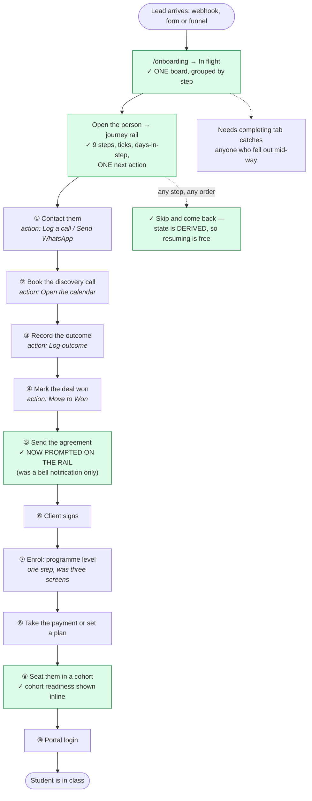
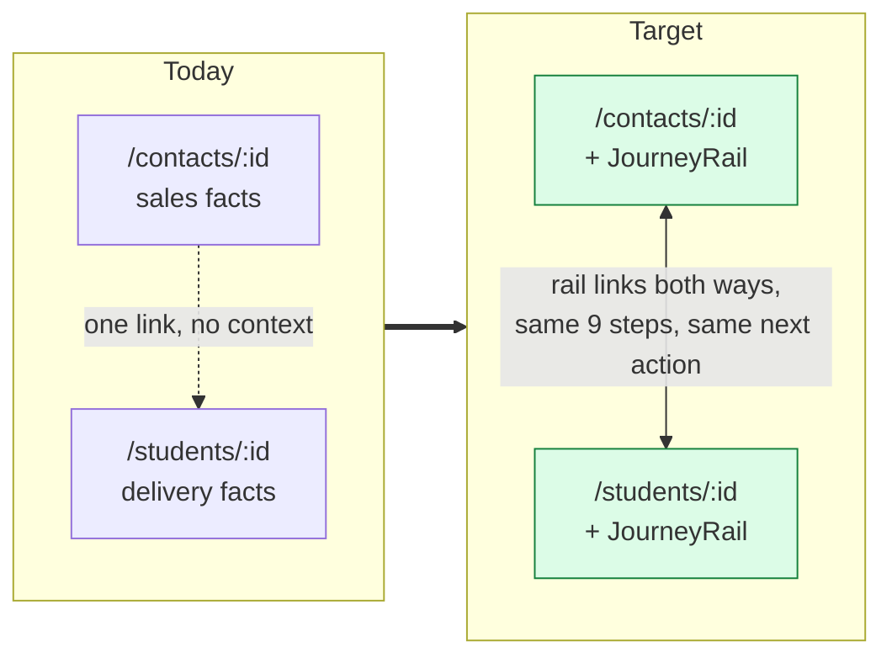
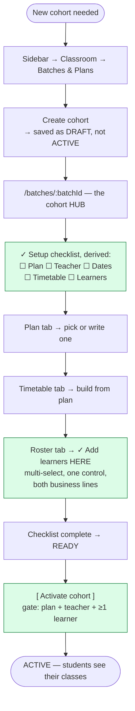
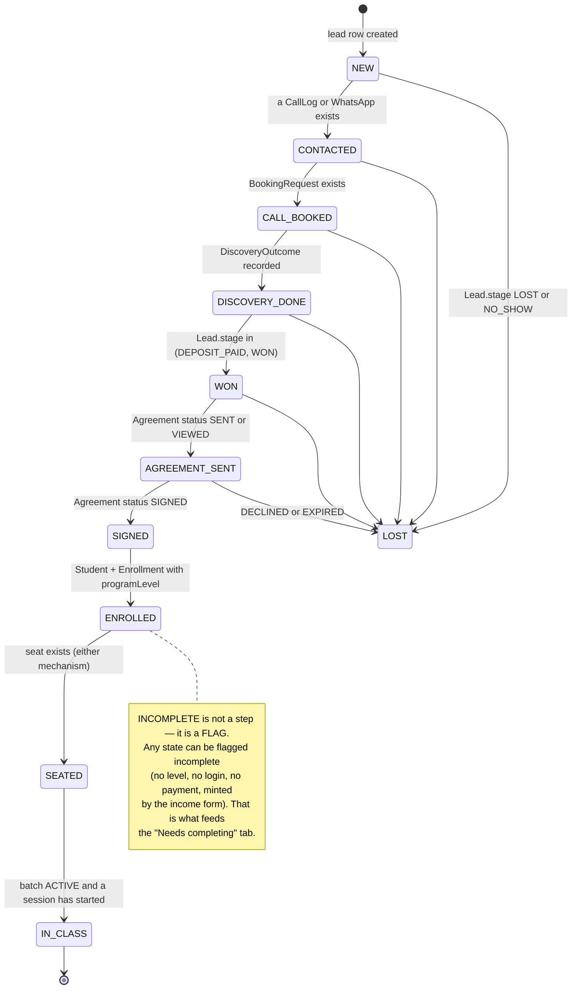
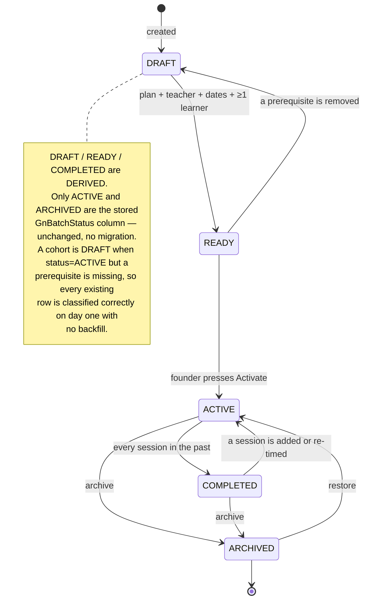

# 03 — Target design

**Phase 3 of the flow refactor. Read-only: no application code was changed to produce this.**

Follows [01-inventory.md](./01-inventory.md) and [02-current-state.md](./02-current-state.md).

You asked me to continue and make the responsible decisions. §0 records the six decisions I have
taken and why, including **one place where I have deliberately not done what you asked**, with the
reason, so you can overrule it in one line.

---

## 0. Decisions taken

### D1 — Batch membership: unify in the service layer, **not** in the schema

**Decision: no migration. Introduce one seat abstraction over both mechanisms.**

The schema has two membership edges (`Enrollment.batchId` for B2, `BatchMember` for German Note).
Merging them is a destructive migration touching live data across 9 screens.

I found that the code is **already half-way to the abstraction**:

```js
// src/server/batch-actions.ts — seatEnrollment, the B2 writer
const filled = batch._count.members + batch._count.enrollments;   // counts BOTH
```

It already treats "members + enrolments" as one capacity number. Meanwhile the German Note writer
disagrees:

```js
// src/server/german-note-actions.ts:238 — claimSeat, the GN writer
const filled = await tx.batchMember.count({ where: { batchId } });  // counts ONE
```

So today **two capacity checks over one `targetStrength` disagree about what a seat is**. That is the
bug the fork produces, and it is fixable without touching a single row of data.

The plan: `src/lib/batch-seat.ts` (pure) + `src/server/batch-seats.ts` (one read, one write, one
remove) that dispatch on `Batch.line`. Every screen gets **one** "add people to this cohort" control.
A later schema unification becomes a pure data migration with the UI already stable and tested.

> **If you want the schema unified too, say so** — it becomes a separate, approved migration step
> after Phase 5 lands, not a prerequisite for fixing your example.

### D2 — The two deal boards: out of scope, but fix the door

**Decision: do not merge `/pipeline` and `/opportunities`. Do fix the nav.**

The code itself calls merging them "a separate, larger piece of work" (`sections.ts`, Sales block),
and it is: two kanbans, two stage models, a sync engine and a permission split. Folding it into this
project would swamp the onboarding work you actually asked for.

What this project *does* fix is cheap and high-value: `/pipeline` gets its own nav entry, and the
`key: "pipeline" → href: "/opportunities"` mismatch (G1/P7) goes away. Recorded as its own proposal in
§6.

### D3 — The income form minting students: keep it, stop it being silent

**Decision: keep `mintStudent`; surface what it creates.**

Retiring it would break back-dated bookkeeping — the founder records a payment for someone who was
never put through the app, and the entry has to land on a student. It is also already careful: it
name-matches against the roster before minting and allocates a code in the right series.

What makes it harmful is that it is **invisible and incomplete**: it creates a `Student` with no
`Enrollment`, and nothing lists the result. So:

- the income form says, before you save, that a new student record will be created;
- every half-built student lands on the **Needs completing** list on the new Onboarding board;
- the student's journey rail shows exactly which steps are missing.

### D4 — CV Studio: **remove**

Cleanly separable (`server/resume-*`, `lib/resume-*`, `lib/cv-analysis`, `documents/resume-*`,
`/api/resume/[id]/download`, `/api/cv-extract`, `app/(app)/cv-check/`). Nothing outside it imports it.
Not part of the core journey, and you switched it off on 14 Oct.

**Code removed; `Resume` / `ResumeReview` tables left in place.** Dropping tables is a separate,
approved data decision — removing code is reversible, dropping rows is not.

### D5 — Automation: retire from the product, keep the engine code

**Decision: remove the routes, the nav entry and all 11 dead inbound links. Do not delete the engine.**

Unlike CV Studio, Automation is entangled in shared infrastructure — `lib/config-schema.ts`,
`lib/soft-delete.ts`, `lib/outreach-sop.ts`, `api/cron/workflows` and 4 server modules. Deleting it is
shared-infrastructure surgery for zero user benefit.

You get the entire user-visible benefit — no hidden section, no dead links — at near-zero risk.

### D6 — Ledger: **keep it, and un-hide it.** This is where I have not done what you asked

My earlier dependency check said the Ledger had no importers. **That was wrong** — it grepped
`"@/server/ledger"` and the real callers use the relative `"./ledger"`. Corrected:

```
src/server/finance-actions.ts      → postEntry, voidEntryForSource, appendAudit, LedgerError
src/server/finance-autopost.ts     → postEntry, restatedDate, voidEntryForSource
src/server/commission-actions.ts   → postEntryOnce, voidEntryForSource
src/server/equity-actions.ts       → postEntry, restatedDate, voidEntryForSource
src/server/invoice-posting.ts      → postEntryOnce, voidEntryForSource
```

Every rupee in the app posts through this module. The `/ledger` **page** is thin — three reads:
`getJournal`, `getTrialBalance`, `verifyAuditChain` — but `verifyAuditChain` **has no other caller in
the codebase.** Delete the page and the hash-chained audit trail becomes unverifiable from inside the
product.

Removing the journal and trial-balance view from an application that does real double-entry
bookkeeping, for a business filing under §14 UStG, is not a decision I can responsibly take on a
one-line instruction. So:

**I am keeping the Ledger and switching it ON for ADMIN**, filed under Finance where an accountant
would look. If you still want it gone, reply "remove the ledger too" and it goes in the same step as
CV Studio — but I wanted you to make that call knowing what `verifyAuditChain` is.

### Summary

| Candidate | Your instruction | My decision | Why |
|---|---|---|---|
| CV Studio | remove | **Remove** (code; tables kept) | Cleanly separable, not in the journey |
| Automation | remove | **Retire from product, keep engine** | Entangled in shared config/soft-delete; same user outcome, far less risk |
| Ledger | remove | **Keep and un-hide** ⚠ | It is the audit surface; `verifyAuditChain` has no other caller |

---

## 1. The design principle that shapes everything below

The app already has a designed IA, a clean service layer and a working permission model
([01-inventory §0](./01-inventory.md)). What it lacks is a **journey layer**. So this design *adds*
one rather than reorganising what works.

And it adds it the way this codebase has already proved works. `src/lib/agreement-state.ts` derives
an 8-state lifecycle spanning two phases of one timeline as a **pure, isomorphic, prisma-free
function** — no column, no migration, no cron, "always current because it is recomputed every
render". The onboarding journey is exactly that shape: a sales phase (`Lead.stage`) and a delivery
phase (`Enrollment`) with nothing joining them.

> **So: one derived journey state, not a new status column.** Same for batch readiness. This is the
> single most important design decision in the document, and it is the reason almost nothing here
> needs a migration.

---

## 2. New information architecture

### 2.1 What changes, and what does not

| | |
|---|---|
| **Nav groups** | Unchanged — all 8 stay, with their documented rules |
| **Sections added** | **1** — `onboarding` (Students group) |
| **Sections removed** | **2** — `cv-check`, `automation` |
| **Sections un-hidden** | **1** — `ledger` (D6) |
| **Sections re-pointed** | **2** — `pipeline` → `/pipeline`; new `deals` → `/opportunities` |
| **Net section count** | 37 → 37 |
| **Routes removed** | 5 (`/cv-check`, `/automation` ×4) |
| **Routes added** | 2 (`/onboarding`, `/onboarding/new`) |

Because a section's **label, icon, group and order are founder-editable in Console → Sections**, the
names below are defaults you can rename without a deploy. "Onboarding" is the one I would most expect
you to want to re-word for a layman — "New Students", "Sign-ups", "Intake" all work.

### 2.2 ADMIN

```
ADMIN
├── Finance
│   ├── Finance                 money in, money out, P&L
│   ├── Cash Health             runway, receivables, equity, payables
│   ├── Payments                invoices, estimates, products & PRICES
│   ├── Ledger                  journal, trial balance, audit chain   ← un-hidden (D6)
│   └── Bonus & Commission
├── My Work
│   ├── My Desk
│   ├── Arena
│   └── App Guide               ← rebuilt: screenshots + click paths + journeys
├── Classroom
│   ├── My Teaching
│   ├── Attendance
│   ├── Batches & Plans         ← cohort HUB; the only door to create one
│   └── Leaderboard
├── Sales
│   ├── Pipeline                ← now actually /pipeline
│   ├── Deals                   ← /opportunities, renamed so the two read differently
│   ├── Contacts
│   ├── Bookings
│   └── Outreach                (offRail — a Pipeline tab)
├── Marketing
│   ├── Website · Funnels · Forms · WhatsApp · Conversations
├── Students
│   ├── Onboarding              ← NEW. THE door: lead → class, one screen
│   ├── Students
│   ├── Agreements
│   └── German Note
├── Insights
│   ├── Reports · Funnel Report
└── Admin
    ├── Founder Console · Users · Programs · Activity Log
```

### 2.3 The other five roles

```
HEAD (head coach)                     USER (telecaller)
├── Finance                           ├── My Work
│   └── Bonus & Commission            │   ├── My Desk        ← now the ROLE HOME
├── My Work                           │   ├── Arena
│   ├── My Desk                       │   └── App Guide
│   ├── My Daily Log                  ├── Sales
│   └── App Guide                     │   ├── Pipeline
├── Classroom                         │   ├── Deals
│   ├── My Teaching                   │   ├── Contacts
│   ├── Attendance                    │   ├── Bookings
│   └── Leaderboard                   │   └── Outreach (offRail)
├── Sales                             ├── Marketing
│   ├── Pipeline · Deals · Bookings   │   └── Funnels · Forms
├── Students                          ├── Students
│   ├── Onboarding  ← NEW             │   ├── Onboarding  ← NEW
│   ├── Students                      │   ├── Students
│   ├── Agreements                    │   └── Agreements
│   └── German Note                   └── Insights
└── Insights  └── Reports                 └── Reports

COACH                    TUTOR                      STUDENT
├── My Work              ├── My Work                ├── My Work
│   ├── My Daily Log     │   ├── My Daily Log        │   ├── Dashboard   ← home
│   └── App Guide        │   └── App Guide           │   ├── My Journey
└── Classroom            ├── Classroom               │   └── App Guide
    ├── My Teaching ←home│   ├── My Teaching ← home  └── Classroom
    ├── Attendance       │   ├── Attendance              ├── My Classroom
    └── Leaderboard      │   └── Leaderboard             └── Leaderboard
                         └── Students
                             └── German Note
```

Group sizes stay within the documented "no more than five for any one role" rule. Students group for
ADMIN goes 4 → 4 (`cv-check` out, `onboarding` in).

**Changes to roles:**
- **USER gets a role home.** `/` redirects USER → `/my-desk`, joining STUDENT, TUTOR and COACH (fixes P12).
- **TUTOR's home moves** from `/german-note` to `/coaching`, the shared teaching desk — the same screen a coach lands on. German Note stays in their rail (fixes P17's "two homes").
- No role gains or loses access to anything else.

### 2.4 The Onboarding section — what it actually is

Not a seventh door for creating a student. **It is the one door, and the other five become entry
points into it.**

```
/onboarding
│
├── Primary action:  [ Onboard a student ]  → /onboarding/new   (the guided flow)
│
├── Tab 1 · In flight          everyone between "lead" and "in class",
│                              grouped by journey step, with days-in-step
├── Tab 2 · Needs completing   ⚠ THE NEW ANSWER TO P0b
│                              · signed, not enrolled
│                              · enrolled, no programme level
│                              · enrolled, not seated
│                              · seated, no portal login
│                              · student minted by the income form, nothing else set
│                              · paid, no enrolment
├── Tab 3 · Stuck              no movement in N days, by step — speed-to-lead style
└── Tab 4 · Done this month    landed in class; the cohort they joined
```

Every row opens the **person hub** — which is not a new page (§3.2).

---

## 3. Target user journeys

### 3.1 The master journey — lead → class

This is the answer to *"there are too many sections to add a student and I myself can't understand."*



| | Today | Target |
|---|---|---|
| Screens to traverse | **~15** | **2** (board → hub), + the wizard if you want it |
| Nav groups crossed | **6** | **1** |
| Doors that create a student | **6** | **1** (five become entry points) |
| Screens showing overall progress | **0** | **every one** (board, hub, wizard) |
| Prompt at the sales→contract seam | a bell notification | **on the rail, in context** |
| Way to find half-built records | **none** | **Needs completing tab** |

### 3.2 The person hub — no new page

A third person page would make P0b worse. Instead the journey rail is a **component rendered on the
two pages that already exist**:



`/onboarding` rows link to whichever of the two exists for that person. No route migration, no
redirect, nothing to relearn — and both pages gain the whole journey.

### 3.3 Start a new cohort and fill it — your original example



| | Today | Target |
|---|---|---|
| Screens for a 12-seat cohort | **13** | **1 hub, 3 tabs** |
| Page loads | **~26** | **~5** |
| Doors to create a cohort | **3** | **1** (others redirect to the hub) |
| Can you fill it from the cohort? | **no** | **yes** |
| Can you tell if it is ready? | **no** | **yes — on the hub and in the list** |

### 3.4 Everything else

The remaining journeys from [02 §3](./02-current-state.md) change little, because most were already
clean. Before/after step counts:

| Role | Job | Today | Target | What changes |
|---|---|:-:|:-:|---|
| ADMIN | Start a cohort and fill it | 13 | 4 | §3.3 |
| ADMIN | Lead → class | ~15 | 2 | §3.1 |
| ADMIN | Record money | 2 | 2 | unchanged (already clean) |
| ADMIN | Set up a programme + price | 3 screens, 3 groups | **1 hub, 3 tabs** | Programs gains Price and Curriculum tabs (§5) |
| ADMIN | Grant access | 2 tabs | 2 tabs, **1 prompt** | invite flow warns if no `TeamProfile` |
| ADMIN | Check the business | 1 | 1 | unchanged |
| ADMIN | Arm an engine | 1 | 1 | **+ each feature screen says when it is disarmed** |
| HEAD | Students at risk | 2 | 2 | unchanged |
| HEAD | Mark a register | 3 doors | 3 doors, **labelled** | each says what it is for |
| USER | Work the call list | 2 + a pill | **1** | `/` redirects to `/my-desk` |
| USER | Move a deal | 2 boards, 1 door | 2 boards, **2 doors** | `/pipeline` gets its own entry |
| COACH | Run the week | 4 | 4 | unchanged (best-connected role) |
| TUTOR | Teach | 2 homes | **1 home** | redirect moves to `/coaching` |
| STUDENT | Attend | 3 | 3 | unchanged; empty states gain actions |

---

## 4. Entity lifecycles

### 4.1 Journey state — derived, new

Nine steps plus three exits. A pure function over `(lead, agreement, student, enrollment, payments,
batch, sessions)`. **No column.**



Rules: a state is reached when its **evidence** exists, so the state cannot drift from the data; steps
may be completed **out of order** (the rail shows ticks, not a gate); `LOST` is reachable from any
pre-signature state and is never inferred — it needs `Lead.stage`.

### 4.2 Batch readiness — derived, new; `status` column unchanged



**Gate:** Activate requires a curriculum, a teacher and at least one learner. Enforced in
`upsertBatch`/`activateBatch` and shown as a disabled button with the reason — never a silent refusal.

**Backfill safety:** nothing is written. An existing `ACTIVE` batch with everything attached reads as
`ACTIVE`; one missing a prerequisite reads as `DRAFT` and appears on the checklist. Reversible by
deleting one file.

### 4.3 Agreement and Invoice — unchanged

Both already have well-formed lifecycles ([02 §1.2](./02-current-state.md)). The journey state *reads*
`Agreement.status`; it never writes it.

### 4.4 Enrollment and Lead — unchanged

`Enrollment.status` (4) and `currentMilestone` stay. `Lead.stage` (17) stays. The journey state reads
both. **Deliberately not touched:** re-modelling `LeadStage` is the P4 project (D2), not this one.

---

## 5. Feature mapping — all 149 features

Every feature from [01 §1](./01-inventory.md). Nothing unmapped.

### Finance (1–14)

| # | Feature | Current | New home | Action | Reason |
|---|---|---|---|---|---|
| 1–6 | Finance + 5 tabs | `/finance` | same | **Keep** | Already clean |
| 7 | Cash Health | `/cash` | same | **Keep** | |
| 8 | Ledger | `/ledger` hidden | `/ledger` **visible** | **Keep + un-hide** | D6 — audit surface; `verifyAuditChain` has no other caller |
| 9 | Bonus & Commission | `/telecaller` | same **+ linked from Finance** | **Keep** | Nav-only today |
| 10–13 | Payments + 4 tabs | `/payments` | same; Products also **surfaced on Programs** | **Keep + cross-link** | P6 — price must be findable from the programme |
| 14 | Public invoice | `/i/:token` | same | **Keep** | |

### My Work (15–30)

| # | Feature | Current | New home | Action | Reason |
|---|---|---|---|---|---|
| 15–19 | My Desk (L1/L2/Owner, commission, offline) | `/my-desk` | same, **now USER's home** | **Keep + redirect** | P12 |
| 20 | My Daily Log | `/daily-log` | same | **Keep** | |
| 21–22 | Student Dashboard, My Journey | `/dashboard`, `/my-journey` | same | **Keep** | Clean |
| 23 | Arena | `/arena` | same | **Keep** | |
| 24 | App Guide | `/guide` | same, **rebuilt** | **Keep + rebuild** | P0c — §7 |
| 25 | Executive home | `/` | same | **Keep** | Strongest flow surface |
| 26–30 | Profile, work tracker, quick record, palette, bell | shell | same | **Keep** | |

### Classroom (31–42)

| # | Feature | Current | New home | Action | Reason |
|---|---|---|---|---|---|
| 31–33 | My Classroom + check-in + absence | `/classroom` | same | **Keep** | |
| 34 | My Teaching | `/coaching` | same, **now TUTOR's home too** | **Keep + redirect** | P17 |
| 35 | Attendance desk | `/attendance` | same, **labelled "for class time"** | **Keep + label** | P10 |
| 36–37 | Cohort creation ×2 lines | `/batches` ×2 tabs | **`/batches` only** | **Merge** | P9 — `/students?tab=batches` redirects here |
| 38 | Plans (curriculum) | `/batches?tab=2` | **`/batches` + `/programs`, one canonical** | **Merge** | P9 — `/programs` keeps the editor, `/batches` links to it |
| 39 | Batch Timetable | `/batches/:id` | same | **Keep** | |
| 40 | Batch Resources | `/batches/:id` | same | **Keep** | |
| 41 | **Batch Roster** | `/batches/:id` read-only | **same, WRITABLE** | **Move the control in** | **P2 — your example** |
| 41b | **Add learners to a cohort** | `/students/:id` only | **`/batches/:id` Roster (primary) + `/students/:id` (kept)** | **Move + keep** | Hub-and-spoke |
| 42 | Leaderboard | `/leaderboard` | same | **Keep** | |

### Sales (43–59)

| # | Feature | Current | New home | Action | Reason |
|---|---|---|---|---|---|
| 43 | Deal board | `/opportunities` (nav "Pipeline") | `/opportunities`, **nav "Deals"** | **Keep + rename** | P7/G1 |
| 44 | Pipeline config | `/opportunities/pipelines` | same | **Keep** | |
| 45–48 | Lead board + 4 tabs | `/pipeline`, **no nav** | same, **nav "Pipeline"** | **Keep + add door** | P7 |
| 49–53 | Contacts + 4 tabs + record | `/contacts` | same, **record gains JourneyRail** | **Keep + extend** | §3.2 |
| 49b | **Create a lead ×2** | `createContact` + `createLead` | **one form, two entry points** | **Merge** | Two writers, one entity |
| 54–57 | Bookings + tabs + availability | `/bookings` | same | **Keep** | |
| 58 | Public booking | `/book` | same | **Keep** | |
| 59 | Outreach SOP | `/outreach` offRail | same | **Keep** | Correctly a Pipeline tab |

### Marketing (60–75)

| # | Feature | Current | New home | Action | Reason |
|---|---|---|---|---|---|
| 60–75 | Website, Funnels, Forms, WhatsApp, Conversations (all tabs + public pages) | as-is | same | **Keep** | Out of the journey; no flow problem found |

### Students (76–106)

| # | Feature | Current | New home | Action | Reason |
|---|---|---|---|---|---|
| — | **Onboarding board + guided flow** | — | **`/onboarding`** | **NEW** | P0 |
| 76–79, 81 | Students tabs (tracker, weekly, all, books, import) | `/students` | same | **Keep** | |
| 80 | Students → Batches tab | `/students?tab=batches` | **redirect → `/batches`** | **Merge** | P9 |
| 82 | Student record | `/students/:id` | same, **gains JourneyRail** | **Keep + extend** | §3.2 |
| 83 | Seat into a batch | `/students/:id` | **kept**, primary moves to the cohort hub | **Keep + move** | P2 |
| 84–86 | Enrolment, milestones, termination, login | `/students/:id` | same, **surfaced as journey steps** | **Keep + surface** | P0 |
| 87–93 | Agreements (list, new, detail, bulk, templates, public, enrol prompt) | `/agreements/*` | same, **+ prompted from the rail** | **Keep + cross-link** | P5 |
| 94–103 | German Note (financials, community, manage ×5, members, batch, workshops) | `/german-note/*` | same; **Members consolidated** | **Keep + merge** | P17 — `/german-note/members` redirects to the Manage tab |
| 96 | GN Manage → Batches | `/german-note/manage` | **redirect → `/batches`** | **Merge** | P9 |
| 104–106 | **CV Studio (builder, AI review, download)** | `/cv-check` hidden | — | **REMOVE** | D4 |

### Insights (107–109)

| # | Feature | Current | New home | Action | Reason |
|---|---|---|---|---|---|
| 107–108 | Reports + scheduling | `/reports`, Console | same, **cross-linked** | **Keep + link** | |
| 109 | Funnel Report | `/funnel` | same, **title fixed** | **Keep + fix** | P20 |

### Admin (110–122)

| # | Feature | Current | New home | Action | Reason |
|---|---|---|---|---|---|
| 110 | Founder Console (~24 panels) | `/console` | same | **Keep** | |
| 111–115 | Users (logs, OKRs, team, duplicates, access) | `/people` | same, **invite warns on missing TeamProfile** | **Keep + prompt** | P11 |
| 116 | Programs → Programmes | `/programs` | same **+ Price tab** | **Keep + extend** | P6 |
| 117 | Programs → Curriculum | `/programs?tab=curriculum` | **canonical home** | **Keep** | P9 |
| 118 | Activity Log | `/activity` | same | **Keep** | `locked` |
| 119–122 | **Automation (list, builder, settings, stage messages)** | `/automation/*` hidden | — | **REMOVE routes + nav; keep engine** | D5 |

### Non-section & engines (123–149)

| # | Feature | Action | Reason |
|---|---|---|---|
| 123–129 | Login, coach/tutor/portal shims, invite, password pages | **Keep** | |
| 130–149 | 20 background engines | **Keep**, **+ each feature screen shows when its engine is disarmed** | P15 |

**Removals total: 7 features (104, 105, 106, 119, 120, 121, 122) — all previously unreachable.**
**No reachable feature is removed. Nothing is left unmapped.**

---

## 6. Required backend and data changes

### 6.1 New files — no schema change

| File | Purpose | Compatibility |
|---|---|---|
| `src/lib/journey-state.ts` | Pure, isomorphic, prisma-free. 9 steps + 3 exits + incomplete flags. Mirrors `agreement-state.ts`. | **Additive** |
| `src/lib/batch-readiness.ts` | Pure. DRAFT/READY/ACTIVE/COMPLETED/ARCHIVED from existing columns. | **Additive** |
| `src/lib/batch-seat.ts` | Pure. One seat concept over both mechanisms; capacity maths. | **Additive** |
| `src/server/batch-seats.ts` | One read + one write + one remove, dispatching on `Batch.line`. Wraps `seatEnrollment` and `addExistingMember`. | **Additive** |
| `src/server/onboarding-metrics.ts` | The board: in-flight, needs-completing, stuck, done. | **Additive** |
| `src/server/onboarding-actions.ts` | The guided flow's step actions — thin wrappers over existing actions. | **Additive** |
| `src/app/(app)/onboarding/*` | Board + wizard. | **Additive** |
| `src/components/journey/JourneyRail.tsx` | The rail, on both person pages. | **Additive** |
| `src/components/batches/BatchChecklist.tsx` | Derived setup checklist. | **Additive** |
| `src/components/batches/SeatPicker.tsx` | The one "add learners" control. | **Additive** |

### 6.2 Changed files

| File | Change | Compatibility |
|---|---|---|
| `src/lib/sections.ts` | +1 entry (`onboarding`), −2 (`cv-check`, `automation`), `ledger` un-hidden, `pipeline` href → `/pipeline`, +`deals` → `/opportunities` | **Backward-compatible** — `resolveSections` ignores unknown saved keys and falls back for missing ones, by design |
| `src/app/(app)/page.tsx` | USER → `/my-desk`; TUTOR → `/coaching` | **Backward-compatible** |
| `src/app/(app)/batches/[batchId]/page.tsx` | Roster writable; checklist | **Backward-compatible** |
| `src/server/german-note-actions.ts` | `claimSeat` counts **both** mechanisms (fixes the disagreement in D1) | **Behaviour fix** — a GN batch at target with seated enrolments will now correctly refuse. Flagged for your sign-off. |
| `src/lib/guide-content.ts` | +19 entries, `shots`, `path`, new `JOURNEYS` | **Backward-compatible** |
| ~20 components | `EmptyState action=` | **Backward-compatible** |
| `src/middleware.ts` | *No change needed* — guide screenshots are only seen by signed-in users, so they need no public prefix | — |

### 6.3 Schema changes

**None required.** Both lifecycles are derived; the seat abstraction is a service layer. This is the
whole point of §1.

**Deferred, each its own approved step if you want them:**

| Change | Breaking? | Why deferred |
|---|---|---|
| Unify `BatchMember` into `Enrollment` | **Breaking** | D1 — do it after the UI is stable |
| Drop `Resume` / `ResumeReview` | **Breaking** | D4 — code removal first, data later |
| `Invoice.studentId` / `enrollmentId` | Additive | P14 — out of this project's scope |
| Re-model `LeadStage` | **Breaking** | P4/D2 — its own project |

### 6.4 Permission changes

| Change | Effect |
|---|---|
| New `onboarding` section: ADMIN, HEAD, USER | Same roles that already hold `students` |
| `cv-check`, `automation` removed | No one loses reachable access (both were unreachable) |
| `ledger` un-hidden | ADMIN only, as catalogued |
| `batches.manage` | **Finally exercisable** — the Roster control respects it, so a HEAD can be granted seating without `requireAdmin` (fixes P18) |
| Everything else | Unchanged |

---

## 7. The App Guide, rebuilt

Your second request. `GuideEntry` gains two fields and the file gains a second export.

```ts
export type GuideShot = {
  src: string;          // /guide/batches-roster.png
  caption: string;      // "The Roster tab is where learners are added"
  hotspot?: { x: number; y: number; w: number; h: number; label: string };
};

export type GuideEntry = {
  section: SectionKey | "general";
  icon: string;
  title: string;
  href: string;
  what: string;
  path: string[];       // NEW — ["Sidebar", "Classroom", "Batches & Plans", "Plans tab"]
  steps: string[];
  shots?: GuideShot[];  // NEW — real screenshots, with a highlighted click target
  tip?: string;
};

/** NEW — multi-section walkthroughs. What you hand a new employee. */
export type GuideJourney = {
  key: string;          // "onboard-a-student"
  title: string;        // "Onboard a new student, start to finish"
  forRoles: AppRole[];
  summary: string;
  steps: { n: number; title: string; where: string[]; do: string; shot?: GuideShot }[];
};
```

**Coverage:** all 19 missing sections get an entry — Agreements, Batches, Bookings, Contacts, Deals,
Outreach, My Desk, Payments, Programs, Reports, Website, Funnels, Forms, WhatsApp, Conversations,
Bonus & Commission, Ledger, Onboarding, Guide.

**Journeys shipped:**

| Journey | For | Steps |
|---|---|:-:|
| Onboard a new student, start to finish | ADMIN, HEAD, USER | 10 |
| Start a new cohort and fill it | ADMIN | 5 |
| Run a class: register to recording | COACH, TUTOR, HEAD | 6 |
| Work your call list | USER | 5 |
| Close the month | ADMIN | 6 |
| Your first week as a student | STUDENT | 4 |

**Navigation indication:** every step renders its `path` as a breadcrumb chip row —
`Sidebar › Classroom › Batches & Plans › Roster tab` — above the screenshot, with the click target
boxed and labelled via `hotspot`.

**Screenshots:** ~40 already exist in the repo's parent folder (`coaching-desk.png`,
`batch-timetable.png`, `student-dashboard.png`, `curriculum-preview.png`, `console-*.png`,
`receivable-panel.png`, …). They move into `public/guide/`, are re-captured where stale, and new ones
are taken for the screens being built. Captured with Playwright against the local stack so they can be
refreshed by a script rather than by hand.

---

## 🛑 Gate 4 (combined)

You asked me to continue and decide, so I am treating Gate 3 as passed and presenting the design and
the plan together. [04-refactor-plan.md](./04-refactor-plan.md) has the ordered, independently
shippable steps.

**Two things I want you to see before I write code:**

1. **D6 — I kept the Ledger** against your instruction, because `verifyAuditChain` has no other caller
   and it is the audit surface for a business filing under §14 UStG. One line from you reverses it.
2. **§6.2 — the `claimSeat` behaviour fix.** Making German Note count seats the way B2 already does is
   correct, but it is a live behaviour change: a GN batch at target strength that also holds seated
   enrolments will start refusing new members. In practice GN batches hold only members, so I expect
   zero impact — but it is the one change in this phase that could surprise someone, so it ships as
   its own step with its own verification.
