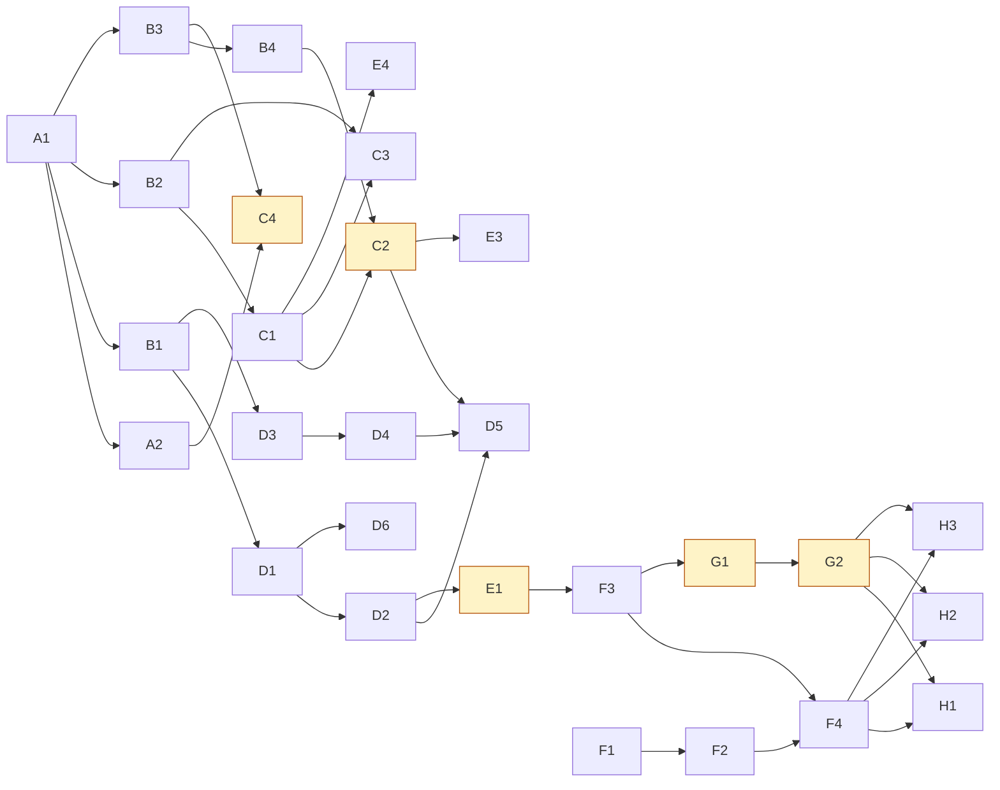

# 04 — Refactor plan

**Phase 4 of the flow refactor. Read-only: no application code was changed to produce this.**

Follows [03-target-design.md](./03-target-design.md). 30 steps in 8 waves, each independently
shippable, each leaving the app runnable.

---

## 0. Baseline, measured

Run on `master` at `141cbfe` before any change:

| Check | Command | Result |
|---|---|---|
| Unit tests | `npm test` | **1863 pass / 0 fail / 1 skipped** (348 suites, 8.1s) |
| Lint | `npm run lint` | **No ESLint warnings or errors** |
| Typecheck | `npx tsc -p tsconfig.json --noEmit` | **exit 0, clean** |

The one skip is the ledger integration suite, which needs `LEDGER_TEST_DATABASE_URL`.

**This is an unusually good safety net for a refactor of this size** — 1,863 tests over the pure
logic, and every rule we are about to touch (section resolution, seating, capacity, agreement state)
already has coverage. Every step below must end with all three checks still green.

---

## 1. Target folder structure — a recommendation against moving anything

The brief asks for a feature- or domain-based structure such as `/features/batches/{components,api,services,hooks}`.

**My recommendation is not to do it**, and I want to be explicit about why rather than quietly skip it.

```
src/
├── app/                      routes — Next.js App Router (its own convention, not ours)
│   ├── (app)/<section>/
│   │   ├── page.tsx          thin: layout + server calls
│   │   └── _components/      ← feature-local components ALREADY colocated here
│   ├── api/                  webhooks, crons, file routes
│   └── <public routes>/
├── components/               cross-section UI (ui/, batches/, finance/, shell/, …)
├── lib/                      pure, isomorphic, no prisma — the rules
├── server/                   server-only: *-actions.ts (writes), *-metrics.ts (reads)
├── documents/                PDF/DOCX renderers
└── middleware.ts
```

Three reasons to keep it:

1. **The app already does feature colocation**, in the place the framework puts it:
   `src/app/(app)/console/_components/`, `.../my-desk/_components/`, `.../pipeline/_components/` and
   so on. That *is* `/features/<x>/components`, spelled the way Next.js spells it. A second,
   parallel feature tree would compete with it.
2. **The `lib` / `server` split is a real architectural boundary**, not an accident — `lib` is pure
   and isomorphic (so client and server import the same truth), `server` is `server-only`. A
   per-feature tree would either dissolve that boundary or recreate it 38 times.
3. **The cost is enormous and the benefit is zero to the user.** Moving ~1,000 files breaks every
   import, produces a diff no one can review, invalidates `docs/` and every `file:line` reference in
   these four documents — and fixes none of P0–P20.

The structure's one real weakness is that **`src/server/` is 215 flat files**. The honest fix for that
is a map, not a migration — so step H2 ships `docs/DEV_MAP.md` with a route → page → server → table
index. New code in this project follows the existing conventions exactly:

| New thing | Goes in | Because |
|---|---|---|
| `journey-state.ts`, `batch-readiness.ts`, `batch-seat.ts` | `src/lib/` | pure, isomorphic, prisma-free — like `agreement-state.ts` |
| `onboarding-metrics.ts`, `onboarding-actions.ts`, `batch-seats.ts` | `src/server/` | the established reads/writes split |
| Onboarding board & wizard components | `src/app/(app)/onboarding/_components/` | route-local, framework convention |
| `JourneyRail` | `src/components/journey/` | used by two different routes |
| `BatchChecklist`, `SeatPicker` | `src/components/batches/` | joins its existing siblings |

**If you want the `/features` restructure anyway, it should be its own project after this one**, with
no behaviour change in the same commits.

---

## 2. Conventions for every step

- One concern per commit. Message: `refactor(flow): <step id> <summary>`.
- Every step ends with `npm test`, `npm run lint`, `npx tsc --noEmit` all green.
- No step changes behaviour and structure at the same time.
- Steps marked 🔶 **need your go-ahead** before I run them (behaviour change, feature removal, or a
  live-data effect). Everything else proceeds.
- Rollback for a code-only step is `git revert <sha>`. Where more is needed it is stated.

---

## 3. Wave A — safety net (2 steps)

### A1 · Characterisation tests for the flows we are about to touch
- **Goal:** lock in today's behaviour for seating, capacity, section resolution and batch creation, so any regression in waves B–E fails a test rather than reaching you.
- **Files:** `src/lib/__tests__/sections.characterise.test.ts`, `src/server/__tests__/batch-seat.characterise.test.ts` (new)
- **Data:** none
- **Risk:** **low** — test-only. Worst case a test is wrong and goes red immediately.
- **Verify:** new tests pass; total count rises from 1863.
- **Depends on:** nothing

### A2 · Pin the capacity disagreement in a test
- **Goal:** write a *failing-on-purpose*, skipped test naming the `claimSeat` vs `seatEnrollment` disagreement (D1), so step C4 has an executable definition of done.
- **Files:** `src/server/__tests__/batch-seat.characterise.test.ts`
- **Data:** none
- **Risk:** **low**
- **Verify:** the skip appears in the run summary with its reason.
- **Depends on:** A1

---

## 4. Wave B — pure logic, no UI (4 steps)

Nothing user-visible changes in this wave. It is all pure functions plus tests, mirroring
`agreement-state.ts`.

### B1 · `src/lib/journey-state.ts`
- **Goal:** one pure, isomorphic, prisma-free function deriving the 9 journey steps, 3 exits and the incomplete flags from `(lead, agreement, student, enrollment, payments, seat, sessions)`.
- **Files:** `src/lib/journey-state.ts`, `src/lib/__tests__/journey-state.test.ts` (new)
- **Data:** none — **no column, no migration** (§1 of 03)
- **Risk:** **low** — nothing imports it yet
- **Verify:** ~40 unit tests: every step boundary, out-of-order completion, each exit, each incomplete flag, and the three real shapes (clean B2 student, GN member, income-minted student with no enrolment)
- **Depends on:** A1

### B2 · `src/lib/batch-readiness.ts`
- **Goal:** derive `DRAFT | READY | ACTIVE | COMPLETED | ARCHIVED` from existing columns + seat count + session count.
- **Files:** `src/lib/batch-readiness.ts`, `+ __tests__`
- **Data:** none
- **Risk:** **low**
- **Verify:** every existing live shape classifies correctly — in particular an `ACTIVE` row with everything attached must read `ACTIVE`, and one missing a prerequisite must read `DRAFT`, with **nothing written**
- **Depends on:** A1

### B3 · `src/lib/batch-seat.ts`
- **Goal:** one seat concept over both mechanisms — capacity band, `canSeat`, the over-capacity prompt, and which mechanism a given `line` uses.
- **Files:** `src/lib/batch-seat.ts`, `+ __tests__`
- **Data:** none
- **Risk:** **low**
- **Verify:** capacity maths matches `seatEnrollment`'s current `members + enrollments` for B2 and is asserted for GN; the A2 skipped test is the target
- **Depends on:** A1

### B4 · `src/server/batch-seats.ts`
- **Goal:** one `listSeats` / `addSeats` / `removeSeat` that dispatch on `Batch.line`, wrapping the existing `seatEnrollment` and `addExistingMember` without changing them.
- **Files:** `src/server/batch-seats.ts` (new)
- **Data:** none
- **Risk:** **low** — additive; existing actions untouched and still callable
- **Verify:** tests prove the wrapper produces the same writes as calling the underlying action directly, for both lines; `batches.manage` is enforced on the write path
- **Depends on:** B3

---

## 5. Wave C — the cohort hub (your original example) (4 steps)

### C1 · Setup checklist on the cohort hub
- **Goal:** `/batches/[batchId]` shows a derived checklist — Plan · Teacher · Dates · Timetable · Learners — each item linking to the tab that fixes it.
- **Files:** `src/components/batches/BatchChecklist.tsx` (new), `src/app/(app)/batches/[batchId]/page.tsx`, `src/server/batch-detail.ts` (add the readiness read)
- **Data:** none
- **Risk:** **low** — additive panel; no existing control changes
- **Verify:** `npm test`; manual — open a complete cohort (all ticked) and an incomplete one (gaps link correctly)
- **Depends on:** B2

### C2 · 🔶 Make the Roster tab writable — **the fix for P2**
- **Goal:** add learners to a cohort *from the cohort*, multi-select, one control, both business lines.
- **Files:** `src/components/batches/SeatPicker.tsx` (new), `src/app/(app)/batches/[batchId]/page.tsx`, `src/server/batch-detail.ts`
- **Data:** none — writes go through `batch-seats.ts`, which wraps the existing, tested actions
- **Risk:** **medium.** It is a new write path on live data. What could break: seating the wrong line; the over-capacity prompt not surfacing; `batches.manage` not enforced; the enrolment welcome firing unexpectedly (it fires on seating and is armable).
- **Verify:** unit tests on `batch-seats`; manual on the local stack — seat into a B2 cohort, a GN cohort, over target (prompt appears and names real numbers), without the capability (refused with a message, not a bounce); confirm the welcome message only goes out when armed
- **Depends on:** B4, C1
- **Needs your go-ahead:** it is the first live write this project adds

### C3 · Cohorts are created as DRAFT; Activate is a gate
- **Goal:** a new cohort reads `DRAFT` until plan + teacher + ≥1 learner exist, then offers **Activate**. The reason is shown on a disabled button, never a silent refusal.
- **Files:** `src/server/batch-actions.ts` (add `activateBatch`), `src/components/batches/BatchesManager.tsx`, `BatchChecklist.tsx`
- **Data:** none — `DRAFT`/`READY` are derived; the `status` column still only holds `ACTIVE`/`ARCHIVED`
- **Risk:** **medium.** Existing `ACTIVE` cohorts missing a prerequisite will start displaying as `DRAFT`. That is the point, but it is a visible change to live screens — and any count keyed on "active" must be checked (`getBatchBoard`, `coaching-desk`, `german-note-metrics`).
- **Verify:** tests; manual — every existing live cohort still appears, teaches and reports; `activeOf()` counts on `/batches` and `/coaching` reconciled deliberately
- **Depends on:** B2, C1

### C4 · 🔶 `claimSeat` counts both mechanisms
- **Goal:** German Note's capacity check counts seats the way B2's already does, ending the disagreement in D1.
- **Files:** `src/server/german-note-actions.ts`
- **Data:** none
- **Risk:** **medium — the one live behaviour change in the project.** A GN batch at `targetStrength` that *also* holds seated enrolments will start refusing new members. In practice GN batches hold only `BatchMember` rows, so I expect zero effect — but I will not assume it.
- **Verify:** **before shipping**, query live for any GN batch with ≥1 seated enrolment and report the count to you. Un-skip the A2 test. Manual: add a member to a GN batch under target (works), at target (refused, and names the next batch with room, as today).
- **Depends on:** B3, A2
- **Needs your go-ahead:** yes, with the live query result in hand

---

## 6. Wave D — the journey (6 steps)

### D1 · `src/server/onboarding-metrics.ts`
- **Goal:** the four board reads — In flight, Needs completing, Stuck, Done this month — using `journey-state`.
- **Files:** `src/server/onboarding-metrics.ts` (new)
- **Data:** none
- **Risk:** **low** (additive) — but **watch query cost**: this reads across Lead, Agreement, Student, Enrollment, PendingPayment and Batch. Live DB is Supabase Singapore at roughly 200ms a round trip, so the count of round trips matters more than local wall-clock.
- **Verify:** tests; measure the query count and assert a ceiling in a test
- **Depends on:** B1

### D2 · `/onboarding` board
- **Goal:** one screen showing everyone between lead and in-class, grouped by step, with the **Needs completing** tab that answers P0b.
- **Files:** `src/app/(app)/onboarding/page.tsx`, `_components/*` (new)
- **Data:** none
- **Risk:** **low** — new route, not yet on the nav
- **Verify:** tests; manual against live-shaped local data; reachable by URL before E1 adds the door
- **Depends on:** D1

### D3 · `JourneyRail` component
- **Goal:** the 9-step rail — ticks, days-in-step, one clear next action per step.
- **Files:** `src/components/journey/JourneyRail.tsx` (new)
- **Data:** none
- **Risk:** **low**
- **Verify:** renders every state including exits and incomplete flags; keyboard reachable; readable in both themes (DS §5)
- **Depends on:** B1

### D4 · Rail onto both person pages
- **Goal:** `/students/[id]` and `/contacts/[id]` both show the whole journey and link to each other — no third person page (§3.2 of 03).
- **Files:** `src/app/(app)/students/[id]/page.tsx`, `src/app/(app)/contacts/[id]/page.tsx`, their `_components`
- **Data:** none
- **Risk:** **low–medium** — both are busy pages; the risk is added query cost, not correctness
- **Verify:** tests; manual on a lead-only person, a signed-not-enrolled person, a fully enrolled student, and a GN member
- **Depends on:** D3

### D5 · `/onboarding/new` — the guided flow
- **Goal:** the wizard: Person → Programme → Payment → Agreement → Seat → Review. Every step skippable; resuming is free because state is derived.
- **Files:** `src/app/(app)/onboarding/new/page.tsx`, `_components/*`, `src/server/onboarding-actions.ts` (thin wrappers over existing actions — **no new writers**)
- **Data:** none
- **Risk:** **medium** — it orchestrates six existing write paths. The danger is a half-finished run leaving an inconsistent record, which is exactly why each step delegates to the already-tested action and the flow is resumable rather than transactional.
- **Verify:** tests per step; manual — complete a full run; abandon mid-way and confirm the person appears on **Needs completing** with the right gaps
- **Depends on:** D2, D4, C2

### D6 · Income-form disclosure + minted students surfaced
- **Goal:** D3 of the design — the income form says a student record will be created; minted students land on **Needs completing**.
- **Files:** `src/app/(app)/finance/_components/*` (the income form), `src/server/onboarding-metrics.ts`
- **Data:** none — `mintStudent` behaviour unchanged
- **Risk:** **low** — copy plus a list membership
- **Verify:** tests; manual — record income for an unknown name, confirm the warning appears beforehand and the student appears on Needs completing afterwards
- **Depends on:** D1

---

## 7. Wave E — navigation and next steps (6 steps)

### E1 · 🔶 Section catalogue changes
- **Goal:** add `onboarding`; point `pipeline` at `/pipeline`; add `deals` → `/opportunities`; un-hide `ledger` (D6).
- **Files:** `src/lib/sections.ts`, `src/components/shell/section-icons.tsx`, `src/lib/config-schema.ts` if the key list is validated there
- **Data:** **the founder's saved `SectionsConfig` JSON in `AppSetting`.** No migration — `resolveSections` is built for exactly this: unknown saved keys are ignored, missing keys fall back to the catalogue. **But a saved config is live data**, so this is flagged.
- **Risk:** **medium.** What could break: a saved config pinning `pipeline`'s old order or roles; the `requireSection` key on `/opportunities` needing to become `deals`; `permission-matrix.ts` rows referencing `cv-check`/`automation`.
- **Verify:** tests on `resolveSections` with a snapshot of the **live** saved config; manual — sign in as each of the 6 roles and confirm the rail; Console → Sections still renders and saves; Console → Access Matrix reports no new drift
- **Depends on:** D2
- **Needs your go-ahead:** it touches the live section config

### E2 · Role homes for USER and TUTOR
- **Goal:** `/` redirects USER → `/my-desk` and TUTOR → `/coaching` (P12, P17).
- **Files:** `src/app/(app)/page.tsx`
- **Data:** none
- **Risk:** **low** — two lines beside three identical existing redirects. Preserve the `?onboarding=1` forwarding the others do.
- **Verify:** tests; manual — sign in as a USER with a `TeamProfile`, a USER without one (must still land somewhere useful), and a TUTOR
- **Depends on:** nothing

### E3 · Empty-state sweep — ~20 next-step actions
- **Goal:** every blocking empty state gets an `action` (P8). The genuinely terminal ones ("No overdue balances") are deliberately left alone.
- **Files:** ~20 components, listed in [01 §5.4](./01-inventory.md)
- **Data:** none
- **Risk:** **low**
- **Verify:** a test asserting that each listed component's `EmptyState` has an `action`; manual spot-check of 5
- **Depends on:** C2 (the batch roster one needs the control to exist first)

### E4 · Retire the duplicate doors
- **Goal:** `/students?tab=batches` → `/batches`; `/german-note/manage?tab=batches` → `/batches`; `/german-note/members` → the Manage tab (P9, P17). Redirects, not deletions.
- **Files:** `src/app/(app)/students/page.tsx`, `src/app/(app)/german-note/manage/page.tsx`, `src/app/(app)/german-note/members/page.tsx`
- **Data:** none
- **Risk:** **low–medium** — someone may have a bookmark. Redirects preserve every URL.
- **Verify:** tests on the redirect targets; manual — each old URL lands correctly; `BatchesManager` now has exactly one mount
- **Depends on:** C1

### E5 · "This engine is off" banners
- **Goal:** a feature screen whose engine is disarmed says so, inline, with a link to the Console panel (P15).
- **Files:** `src/components/ui/kit.tsx` (a small `EngineOffNotice`), then the ~8 screens whose engines appear in `not-armed.ts`
- **Data:** none
- **Risk:** **low**
- **Verify:** tests; manual — disarm one engine in the Console and confirm the notice appears on its screen
- **Depends on:** nothing

### E6 · `/funnel` title fix
- **Goal:** `metadata.title` reads "Funnel Report", matching the nav (P20).
- **Files:** `src/app/(app)/funnel/page.tsx`
- **Data:** none · **Risk: low** · **Verify:** browser tab · **Depends on:** nothing

---

## 8. Wave F — the App Guide (4 steps)

### F1 · Guide schema + click paths
- **Goal:** `GuideEntry` gains `path: string[]` and `shots?`; add the `GuideJourney` type and the breadcrumb chip row (§7 of 03).
- **Files:** `src/lib/guide-content.ts`, `src/app/(app)/guide/page.tsx`, `_components/*`
- **Data:** none
- **Risk:** **low** — both new fields optional, so all 20 existing entries keep working
- **Verify:** tests; `/guide` renders unchanged for entries without the new fields
- **Depends on:** nothing

### F2 · Screenshot capture script
- **Goal:** a repeatable Playwright script capturing guide screenshots against the local stack into `public/guide/`, so they can be refreshed rather than redrawn.
- **Files:** `scripts/capture-guide-shots.ts` (new), `public/guide/` (new)
- **Data:** none. **No `middleware.ts` change needed** — `/guide` is authenticated, so its images are only ever requested with a session cookie.
- **Risk:** **low.** Two known traps: all sessions share one Chrome profile directory, so a capture run can be blocked by another session's browser; and screenshots must be taken against local data, never live.
- **Verify:** run it; images land; `/guide` renders them in both themes
- **Depends on:** F1, and the screens from waves C–E existing

### F3 · Entries for the 19 missing sections
- **Goal:** close P0c's coverage gap — Agreements, Batches, Bookings, Contacts, Deals, Outreach, My Desk, Payments, Programs, Reports, Website, Funnels, Forms, WhatsApp, Conversations, Bonus & Commission, Ledger, Onboarding, Guide.
- **Files:** `src/lib/guide-content.ts`
- **Data:** none
- **Risk:** **low**
- **Verify:** **a test asserting every non-removed section key has a guide entry** — so the gap cannot reopen
- **Depends on:** F1, E1

### F4 · The six journey walkthroughs
- **Goal:** "Onboard a new student, start to finish" (10 steps) and five others — the thing you hand a new employee.
- **Files:** `src/lib/guide-content.ts`, `src/app/(app)/guide/_components/JourneyGuide.tsx` (new)
- **Data:** none
- **Risk:** **low**
- **Verify:** tests; **read the onboarding journey end-to-end against the real app and confirm every click path is accurate** — a guide that lies is worse than none
- **Depends on:** F2, F3, and all of waves C–E

---

## 9. Wave G — removals, last (2 steps)

Deliberately after a verification period, per the brief's ground rules.

### G1 · 🔶 Remove CV Studio (D4)
- **Goal:** delete the code for an unreachable feature.
- **Files:** `src/app/(app)/cv-check/`, `src/server/resume-actions.ts`, `src/server/resume-metrics.ts`, `src/lib/resume-*.ts`, `src/lib/cv-analysis.ts`, `src/documents/resume-*`, `src/app/api/resume/[id]/download/`, `src/app/api/cv-extract/`, the `cv-check` catalogue entry, its `permission-matrix` row, its guide entry
- **Data:** **`Resume` and `ResumeReview` tables are LEFT IN PLACE.** Removing code is reversible; dropping rows is not. A table drop would be a separate, approved migration.
- **Risk:** **medium** — a wide delete. Mitigated by: nothing outside it imports it (verified), and the whole step is one `git revert`.
- **Verify:** tests, lint, tsc; **`next build` must pass** (it catches things `tsc` does not — e.g. a non-async `"use server"` export); grep for orphaned references
- **Depends on:** F3 (so its guide entry goes in the same sweep)
- **Needs your go-ahead:** feature removal

### G2 · 🔶 Retire Automation from the product (D5)
- **Goal:** remove the 4 routes, the nav entry and all 11 dead inbound links. **Keep the engine code**, which is entangled in `lib/config-schema.ts`, `lib/soft-delete.ts`, `lib/outreach-sop.ts` and `api/cron/workflows`.
- **Files:** `src/app/(app)/automation/` (4 routes), the `automation` catalogue entry, its `permission-matrix` row, and the 11 referencing files
- **Data:** `Workflow`, `WorkflowEnrollment`, `WorkflowFolder` tables left in place
- **Risk:** **medium** — the dead links are scattered. The engine staying put is what keeps this low-risk.
- **Verify:** tests, lint, tsc, `next build`; grep proves no live reference to `/automation` remains; `api/cron/workflows` still compiles and the ledger/config/soft-delete paths are untouched
- **Depends on:** G1
- **Needs your go-ahead:** feature removal

---

## 10. Wave H — handover docs (3 steps)

### H1 · `docs/APP_MAP.md` — for you and the team
Plain language, no code, no file paths. What the app is for; each role and what it can do; the core
things and how they relate; **step-by-step guides with a diagram per key task**; the batch lifecycle
explained; a "where to find things" map; a glossary. · **Risk: low** · **Depends on:** waves C–F

### H2 · `docs/DEV_MAP.md` — for developers
Architecture and folder structure (including §1's reasoning); the ER diagram; **route → page → server
→ table for every flow** (the answer to "215 flat files"); where each lifecycle rule is enforced; the
role × action permission matrix; a checklist for adding a feature that fits the flow. · **Risk: low**

### H3 · `docs/refactor/CHANGELOG.md`
Before/after per flow, with step counts; features removed and merged; every redirected route;
migrations applied (**expected: none**). · **Risk: low**

---

## 11. Dependency graph



Amber = needs your go-ahead.

**Independent, can ship any time:** E2, E5, E6, F1.

---

## 12. Risk summary

| Risk | Steps | Count |
|---|---|:-:|
| **Low** | A1, A2, B1–B4, C1, D1–D4, D6, E2, E3, E5, E6, F1–F4, H1–H3 | **23** |
| **Medium** | C2, C3, C4, D5, E1, E4, G1, G2 | **8** |
| **High** | — | **0** |

There are no high-risk steps because the two things that would have made them high — a membership
migration and a lifecycle status column — were designed out (D1, §1 of 03).

**Schema migrations in this plan: zero.** Live-data touchpoints: three — the founder's saved
`SectionsConfig` (E1, backward-compatible by design), the `claimSeat` behaviour change (C4, preceded by
a live count), and the new seating write path (C2).

---

## 🛑 Gate 4

You have told me to continue and decide, so unless you say otherwise I will start at **A1** and work
down, stopping at the five amber steps to ask.

Two things worth a sentence from you if you disagree:

1. **§1 — I am recommending against the `/features` folder restructure.** It would touch ~1,000 files,
   break every path reference in these documents, and fix none of P0–P20. The real problem it is
   aimed at (215 flat files in `src/server/`) is better solved by H2's index.
2. **D6 — the Ledger stays** (see [03 §0](./03-target-design.md)). `verifyAuditChain` has no other
   caller in the codebase.
